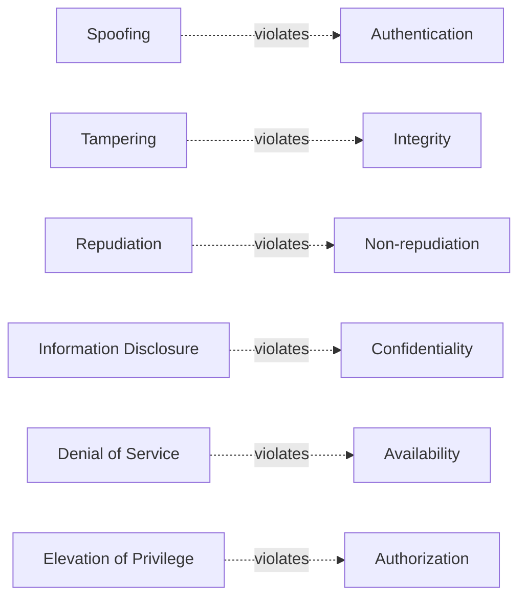
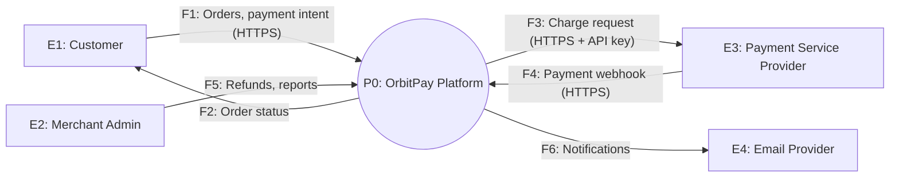
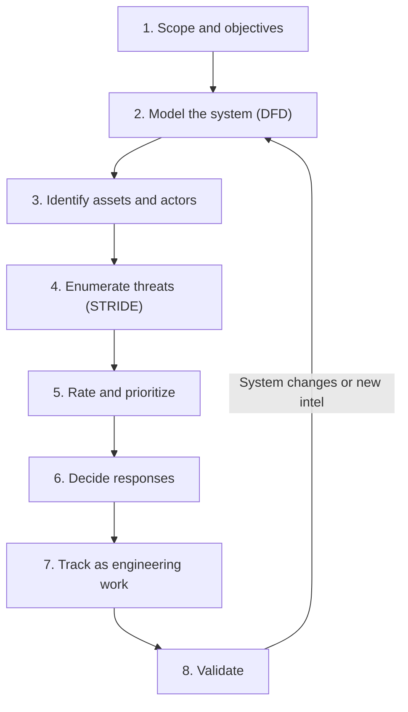
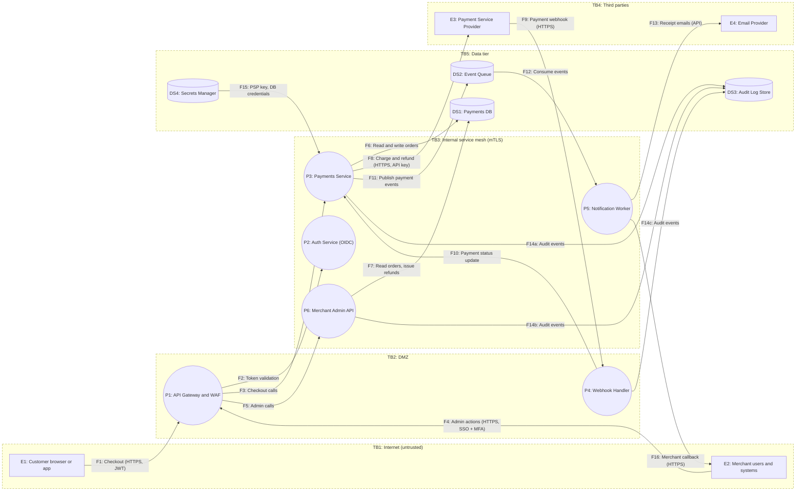
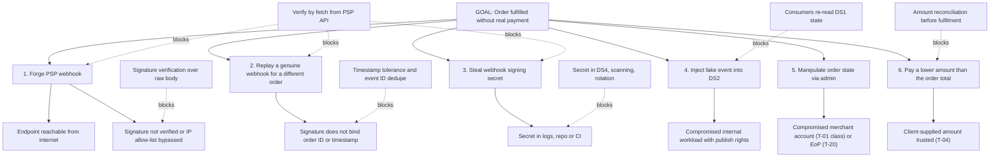
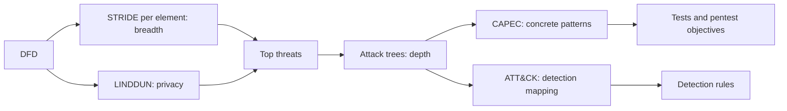

# STRIDE Threat Modeling: A Practitioner's Guide

[](https://github.com/BAKROOT/stride-threat-modeling/actions/workflows/validate-threat-models.yml)
[](LICENSE)
[](LICENSE-CODE)

> Finding design-level security flaws before attackers do, using STRIDE, data flow diagrams, and a repeatable engineering process.

**Author:** Bilal Ahmad Kamal, PhD Cybersecurity Scholar
**Audience:** Security engineers, architects, penetration testers, AppSec and product security teams, security researchers, and developers who want to think like attackers at design time.
**Status:** Living document. Contributions welcome (see [Contributing](#contributing)).

---

## How to Use This Guide

This guide is structured as a learning path. Read it front to back the first time; use it as a reference afterwards.

| Level | You will be able to | Read |
|---|---|---|
| **Foundation** | Explain what threat modeling is, why it matters, and what each STRIDE letter means | Part I |
| **Practitioner** | Draw a correct data flow diagram, run STRIDE-per-element, rate risk, and produce a threat register a team can act on | Part II and Part III |
| **Expert** | Adapt STRIDE to cloud, AI/LLM, CPS/OT and supply chain systems, automate it in CI/CD, and combine it with ATT&CK, CAPEC, attack trees and privacy methods | Part IV |
| **Program Lead** | Build and scale a threat modeling program, measure it, and use threat models to drive pentest scoping, detection engineering and architecture decisions | Part V |

Appendices contain a question bank, templates, a mitigation catalog, a glossary and references that you can copy straight into your own repositories.

## What's in This Repository

| Path | Contents |
|---|---|
| [`README.md`](README.md) | This guide |
| [`cheatsheets/stride-cheatsheet.md`](cheatsheets/stride-cheatsheet.md) | One-page summary for design reviews |
| [`templates/`](templates/) | Threat model document template, `threats.yaml` register template and JSON Schema, CSV register, PR security-design checklist |
| [`examples/orbitpay/`](examples/orbitpay/) | The Part III case study as a complete, version-controlled model: 25 threats in YAML, CSV export, runnable [pytm](https://github.com/OWASP/pytm) model, generated DFD and coverage matrix |
| [`tools/validate_threats.py`](tools/validate_threats.py) | Policy-as-code checker for `threats.yaml`: schema, risk arithmetic, band calibration, element references, blocking of open High/Critical threats, risk-acceptance expiry, STRIDE coverage matrix |
| [`tools/yaml_to_csv.py`](tools/yaml_to_csv.py) | Exports a register to the Appendix C spreadsheet layout |
| [`.github/workflows/`](.github/workflows/) | CI that runs the validator and tests on every push and pull request (Section 14.3 in practice) |

Quick start:

```bash
git clone https://github.com/BAKROOT/stride-threat-modeling.git && cd stride-threat-modeling
pip install -r tools/requirements.txt
python3 tools/validate_threats.py examples/orbitpay/threats.yaml --coverage

# Start your own model
mkdir -p ../my-service/threat-model
cp templates/threat-model-template.md ../my-service/threat-model/README.md
cp templates/threats.yaml ../my-service/threat-model/threats.yaml
```

---

## Table of Contents

- [Part I: Foundations](#part-i-foundations)
  - [1. What Threat Modeling Is and Is Not](#1-what-threat-modeling-is-and-is-not)
  - [2. Core Vocabulary](#2-core-vocabulary)
  - [3. STRIDE: Origins and Mental Model](#3-stride-origins-and-mental-model)
  - [4. The Six Categories in Depth](#4-the-six-categories-in-depth)
- [Part II: The Method](#part-ii-the-method)
  - [5. Modeling the System with Data Flow Diagrams](#5-modeling-the-system-with-data-flow-diagrams)
  - [6. STRIDE per Element and per Interaction](#6-stride-per-element-and-per-interaction)
  - [7. The End-to-End Process](#7-the-end-to-end-process)
  - [8. Rating and Prioritizing Threats](#8-rating-and-prioritizing-threats)
  - [9. Responding to Threats](#9-responding-to-threats)
  - [10. Validating and Closing the Loop](#10-validating-and-closing-the-loop)
- [Part III: Worked Example](#part-iii-worked-example)
  - [11. Case Study: OrbitPay](#11-case-study-orbitpay)
- [Part IV: Advanced Practice](#part-iv-advanced-practice)
  - [12. STRIDE Across Domains](#12-stride-across-domains)
  - [13. Extensions and Complementary Methods](#13-extensions-and-complementary-methods)
  - [14. Threat Modeling as Code and in DevSecOps](#14-threat-modeling-as-code-and-in-devsecops)
- [Part V: Program Leadership](#part-v-program-leadership)
  - [15. Building and Scaling a Program](#15-building-and-scaling-a-program)
  - [16. Using Threat Models Offensively and Defensively](#16-using-threat-models-offensively-and-defensively)
  - [17. Anti-Patterns and Hard-Won Lessons](#17-anti-patterns-and-hard-won-lessons)
- [Appendices](#appendices)
  - [Appendix A: STRIDE Question Bank](#appendix-a-stride-question-bank)
  - [Appendix B: Threat Model Document Template](#appendix-b-threat-model-document-template)
  - [Appendix C: Threat Register Template](#appendix-c-threat-register-template)
  - [Appendix D: Mitigation Catalog](#appendix-d-mitigation-catalog)
  - [Appendix E: Session Facilitation Kit](#appendix-e-session-facilitation-kit)
  - [Appendix F: Glossary](#appendix-f-glossary)
  - [Appendix G: References and Further Reading](#appendix-g-references-and-further-reading)
- [Contributing](#contributing)
- [License](#license)

---

# Part I: Foundations

## 1. What Threat Modeling Is and Is Not

**Threat modeling is the structured analysis of a representation of a system to identify what can go wrong, and to decide what to do about it.** It is a design activity. Its output is not a document; its output is *better decisions*, captured in a form that survives the meeting.

The most widely used framing comes from Adam Shostack's **Four Question Framework**:

1. **What are we working on?** (model the system)
2. **What can go wrong?** (identify threats; this is where STRIDE lives)
3. **What are we going to do about it?** (respond: mitigate, eliminate, transfer, accept)
4. **Did we do a good enough job?** (validate the model, the threats and the responses)

Every method in this guide, however sophisticated, is an answer to one of those four questions.

### 1.1 Why it matters

- **Cost of change.** A missing authorization check found on a whiteboard costs a conversation. The same flaw found in production costs an incident, a patch cycle, possibly a breach notification.
- **Class of flaw.** Scanners and pentests are good at finding *implementation bugs*. Threat modeling is good at finding *design flaws*: missing trust boundaries, implicit trust in third parties, absent audit trails, authorization models that cannot express the business rules. These are the flaws that become systemic.
- **Shared understanding.** The act of drawing the system with the people who build it routinely surfaces things nobody knew: an undocumented admin endpoint, a service account shared across environments, a "temporary" S3 bucket.
- **Regulatory and contractual pull.** Secure development frameworks such as NIST SSDF (SP 800-218), OWASP SAMM (Design / Threat Assessment), sector rules such as the US FDA premarket cybersecurity guidance for medical devices, ISO/SAE 21434 for automotive (TARA), IEC 62443 for industrial systems, and the EU Cyber Resilience Act's cybersecurity risk assessment obligations all expect a documented, design-level analysis of threats. A good threat model is the evidence.

### 1.2 What threat modeling is not

| Misconception | Reality |
|---|---|
| "It's a document we produce for audit." | The document is a by-product. The value is in decisions and changed designs. |
| "It's a one-off activity before launch." | Systems change every sprint. A threat model that is not maintained decays into fiction. |
| "Only the security team can do it." | Security facilitates; engineers who own the system must participate. The best threat modelers are often the people who know where the bodies are buried. |
| "It's the same as a risk assessment." | Related, but threat modeling is grounded in a model of the system's structure and data flows. Enterprise risk assessments often stay at the asset or business-process level. |
| "It's the same as a pentest." | A pentest tests an implementation against an attacker's effort budget. A threat model reasons about a design against an attacker's goals. They feed each other (see Section 16). |
| "We need the perfect tool first." | A whiteboard and the four questions beat any tool used badly. |

### 1.3 When to threat model

- **New system or major feature** at design time (ideal), before significant code is written.
- **Significant change** to an existing system: new trust boundary, new external dependency, new data class (for example, starting to store health or payment data), new authentication mechanism, new deployment model.
- **Before a pentest or red team**, to scope it intelligently.
- **After an incident**, to ask what other paths lead to the same impact.
- **Continuously**, at the user-story level, as part of normal engineering (Section 14).

### 1.4 The Threat Modeling Manifesto

In 2020 a group of practitioners published the [Threat Modeling Manifesto](https://www.threatmodelingmanifesto.org/), which captures the community's consensus values. In paraphrase, it favors:

- a culture of finding and fixing design issues over checkbox compliance;
- people and collaboration over processes, methodologies and tools;
- a journey of understanding over a security or privacy snapshot;
- doing threat modeling over talking about it;
- continuous refinement over a single delivery.

Keep these in mind. Every anti-pattern in Section 17 is a violation of one of them.

---

## 2. Core Vocabulary

Precise language prevents muddled threat registers. These definitions are used consistently throughout the guide.

| Term | Definition | Example |
|---|---|---|
| **Asset** | Something of value that the system must protect, or that an attacker wants. Can be data, capability, availability, reputation, or a stepping stone. | Card tokens; the ability to issue refunds; the signing key; uptime of checkout. |
| **Threat** | A potential, undesired event caused by an adversary (or by accident) that would harm an asset. Expressed as *who could do what to which asset, causing what impact*. | An external attacker forges a payment webhook to mark an unpaid order as paid. |
| **Threat actor** | The entity that could realize a threat, characterized by motivation, capability, and access. | Opportunistic fraudster; malicious insider with DB read access; nation-state APT. |
| **Attack** | A specific technique used to realize a threat. Threats are *what*; attacks are *how*. | Replaying a captured webhook; brute-forcing a weak HMAC secret. |
| **Vulnerability** | A weakness in design, implementation, or operation that allows an attack to succeed. | Webhook endpoint does not verify signatures. |
| **Control / Mitigation** | A measure that reduces likelihood or impact of a threat. | HMAC signature verification with timestamp and replay window. |
| **Risk** | A function of likelihood and impact for a threat, given current controls. | High: easy to exploit, direct financial loss. |
| **Trust boundary** | A line across which the level of trust changes: different privilege, different owner, different administrative domain, different execution context. | Internet to API gateway; app container to host kernel; your VPC to a SaaS provider. |
| **Attack surface** | The set of entry points (and exit points) where an attacker can interact with the system. | Public APIs, webhooks, admin UI, CI/CD triggers, file uploads, message queues. |
| **Entry point** | A specific interface through which data or control enters a component. | `POST /v1/webhooks/psp` |
| **Assumption** | Something the model takes as true without verifying it. Assumptions are first-class outputs; invalid assumptions are where breaches live. | "The PSP's IP range is stable and only the PSP can send from it." |
| **Security property** | A guarantee the system intends to provide. | Authentication, integrity, non-repudiation, confidentiality, availability, authorization. |

> **Expert note.** Keep a strict separation between *threat*, *vulnerability* and *mitigation* in your register. Teams that write "Missing input validation" as a threat end up with a vulnerability list, not a threat model, and lose the ability to reason about impact and alternative attack paths.

---

## 3. STRIDE: Origins and Mental Model

### 3.1 Origins

STRIDE was introduced at Microsoft in 1999 by **Loren Kohnfelder and Praerit Garg** in an internal paper, *"The Threats to Our Products"*. It was later embedded in the Microsoft Security Development Lifecycle (SDL) and popularized by Michael Howard, David LeBlanc, Frank Swiderski, Window Snyder and, most influentially for modern practice, Adam Shostack, whose book *Threat Modeling: Designing for Security* (Wiley, 2014) remains the canonical text.

### 3.2 The mnemonic

Each STRIDE category is the *violation* of a desirable security property:

| Letter | Threat | Property violated | One-line definition |
|---|---|---|---|
| **S** | Spoofing | Authentication | Pretending to be something or someone you are not. |
| **T** | Tampering | Integrity | Modifying data, code, or configuration without authorization. |
| **R** | Repudiation | Non-repudiation (accountability) | Denying having performed an action, or making it impossible to prove who did. |
| **I** | Information Disclosure | Confidentiality | Exposing information to someone not authorized to see it. |
| **D** | Denial of Service | Availability | Degrading or denying service to legitimate users. |
| **E** | Elevation of Privilege | Authorization | Gaining capabilities you are not authorized to have. |



### 3.3 The correct mental model: STRIDE is a lens, not a taxonomy

This is the single most important idea for practitioners to internalize.

STRIDE is a **prompt for finding threats**, not a classification scheme for filing them. Its job is to make you ask six different questions about every part of your system, so you do not stop after finding the obvious SQL injection. Real attacks routinely span categories:

- An IDOR (`GET /invoices/1043` returning someone else's invoice) is *Information Disclosure* from the victim's point of view and *Elevation of Privilege* (horizontal) from the attacker's.
- Stolen session cookies enable *Spoofing*, which typically leads to *Information Disclosure* and *Tampering*.
- Deleting audit logs is *Tampering* with a data store whose purpose is *non-repudiation*.

If a team spends ten minutes debating whether something is T or E, the facilitator should stop the debate, pick one, and move on. **Finding the threat is the value; the label is bookkeeping.**

### 3.4 What STRIDE does not do well on its own

Being honest about limits is what separates experts from enthusiasts:

- **Privacy harms** (linkability, identifiability, unawareness, non-compliance) are poorly covered. Pair with LINDDUN (Section 13).
- **Lateral movement and multi-stage campaigns** are not explicit. STRIDE-LM and ATT&CK help.
- **Business logic abuse** (coupon stacking, refund loops, race-condition fraud) is findable with STRIDE but not naturally prompted by it. Add abuse cases and "persona non grata" exercises.
- **Safety and physical consequences** in cyber-physical systems require safety-security co-analysis (STPA-Sec, HAZOP-style methods).
- **Prioritization** is not part of STRIDE. You need a separate rating approach (Section 8).

---

## 4. The Six Categories in Depth

Each category below follows the same structure: what it is, where it applies, typical attacks, questions to ask, standard mitigations, and reference mappings to CWE (weaknesses), CAPEC (attack patterns) and MITRE ATT&CK (adversary techniques). The mappings are illustrative entry points, not exhaustive lists.

### 4.1 S: Spoofing

**Definition.** An attacker impersonates a user, process, device, or system to gain the trust that identity confers.

**Applies to:** external entities (users, third-party systems, devices) and processes. Anything that has an identity can be spoofed.

**Typical attacks**

- Credential stuffing, password spraying, phishing for credentials or MFA codes, MFA fatigue.
- Session hijacking: stolen cookies, token theft via XSS, session fixation.
- Forged or replayed tokens: JWT `alg:none`, algorithm confusion (RS256 to HS256), unsigned or weakly signed SAML assertions, missing `aud`/`iss` validation.
- Service impersonation: DNS hijacking, rogue DHCP, ARP spoofing, typo-squatted domains, malicious OAuth apps, forged webhooks.
- Device spoofing: cloned RFID badges, spoofed MAC/IMEI, GNSS spoofing in navigation systems, spoofed ADS-B in aviation surveillance.
- Workload identity abuse: stolen cloud instance metadata credentials, Kubernetes service account token theft.

**Questions to ask**

- How does each component know who is on the other end of every connection? Is it *proven* (cryptographically) or *asserted* (header, IP, field in the payload)?
- What happens if a credential, token, API key or certificate is stolen? How long is it valid? Can it be revoked? Is it bound to a device or channel?
- Do services authenticate *each other*, or only users at the edge?
- Can a third party (PSP, IdP, SaaS) be impersonated toward us? Can we be impersonated toward our users (phishing look-alikes, email spoofing)?

**Mitigations**

- Strong authentication: phishing-resistant MFA (FIDO2/WebAuthn, passkeys), risk-based authentication, rate limiting and lockout with care for DoS side effects.
- Robust session management: secure, HttpOnly, SameSite cookies; short-lived tokens with rotation; token binding (DPoP, mTLS-bound tokens) where feasible.
- Strict token validation: pinned algorithms, `iss`, `aud`, `exp`, `nbf` checks; key rotation via JWKS with caching discipline.
- Mutual authentication for service-to-service traffic: mTLS (service mesh), workload identity (SPIFFE/SPIRE, cloud IAM roles), no long-lived static keys.
- Message authentication for asynchronous inputs: HMAC or signatures on webhooks with timestamp and replay protection.
- Anti-spoofing for email and domains: SPF, DKIM, DMARC with enforcement; certificate transparency monitoring.

**Reference mappings**

| Framework | Examples |
|---|---|
| CWE | CWE-287 Improper Authentication; CWE-290 Authentication Bypass by Spoofing; CWE-294 Capture-replay; CWE-307 Excessive Authentication Attempts; CWE-384 Session Fixation; CWE-347 Improper Verification of Cryptographic Signature |
| CAPEC | CAPEC-151 Identity Spoofing; CAPEC-593 Session Hijacking; CAPEC-60 Reusing Session IDs; CAPEC-94 Adversary in the Middle |
| ATT&CK | T1078 Valid Accounts; T1110 Brute Force; T1566 Phishing; T1557 Adversary-in-the-Middle; T1550 Use Alternate Authentication Material |

---

### 4.2 T: Tampering

**Definition.** Unauthorized modification of data in transit, data at rest, data in use, code, or configuration.

**Applies to:** processes, data stores, and data flows.

**Typical attacks**

- Injection: SQL, NoSQL, command, LDAP, template injection, XXE, which all tamper with the *interpretation* of data.
- Parameter tampering: price or quantity manipulation, mass assignment, hidden field modification.
- Man-in-the-middle modification on unencrypted or improperly validated channels.
- Direct tampering with stores: modifying database rows, object storage, caches, message queues.
- Code and supply chain tampering: compromised dependencies, malicious build steps, poisoned CI caches, unsigned artifacts, container image substitution.
- Configuration tampering: infrastructure-as-code drift, modified feature flags, altered IAM policies.
- Client-side tampering: modified mobile binaries, instrumented apps (Frida), manipulated local storage.
- Memory tampering: buffer overflows, use-after-free (implementation-level, but threat modeling should note where memory-unsafe parsers handle untrusted input).

**Questions to ask**

- Where does untrusted data enter, and where is it *interpreted* (by SQL engines, shells, template engines, deserializers, browsers)?
- Which data does the server trust that originated from the client?
- Is every data flow crossing a trust boundary integrity-protected? End to end, or only hop by hop?
- Who can write to each data store, including through backups, replicas, admin tools and break-glass access?
- Can we prove that the code running in production is the code we reviewed and built?

**Mitigations**

- Parameterized queries, safe APIs, contextual output encoding, schema validation and allow-lists at trust boundaries.
- Server-side authority for business-critical values (prices, entitlements, balances); never trust client-calculated values.
- TLS 1.2+ (prefer 1.3) with certificate validation; mTLS internally; message-level signatures where data passes through intermediaries.
- Least-privilege write access; immutable or append-only storage for critical records; database-level constraints.
- Supply chain integrity: dependency pinning and verification, SBOMs, signed artifacts (Sigstore/cosign), provenance attestations (SLSA), protected branches, reviewed CI configuration, ephemeral isolated build runners.
- File integrity monitoring and configuration drift detection; policy-as-code guardrails.
- Avoid unsafe deserialization of untrusted input entirely.

**Reference mappings**

| Framework | Examples |
|---|---|
| CWE | CWE-20 Improper Input Validation; CWE-89 SQL Injection; CWE-78 OS Command Injection; CWE-502 Deserialization of Untrusted Data; CWE-345 Insufficient Verification of Data Authenticity; CWE-352 CSRF; CWE-494 Download of Code Without Integrity Check; CWE-915 Mass Assignment |
| CAPEC | CAPEC-66 SQL Injection; CAPEC-88 OS Command Injection; CAPEC-94 Adversary in the Middle; CAPEC-538 Open-Source Library Manipulation |
| ATT&CK | T1565 Data Manipulation; T1195 Supply Chain Compromise; T1190 Exploit Public-Facing Application; T1554 Compromise Host Software Binary |

---

### 4.3 R: Repudiation

**Definition.** A user or attacker performs an action and the system cannot prove it, either because evidence was never captured, was captured insufficiently, or was destroyed or altered.

Repudiation is the most misunderstood STRIDE category. It has two faces:

1. **Legitimate-user repudiation.** A customer claims "I never authorized that transfer" and you cannot prove otherwise. This is a business and legal risk.
2. **Attacker-driven repudiation.** An attacker acts and then erases or falsifies the trail, defeating incident response and attribution.

**Applies to:** external entities (who might deny actions), processes (which must record them), and data stores that serve as logs or audit trails.

**Typical attacks**

- Performing sensitive actions through paths that are not logged (internal APIs, batch jobs, DB consoles, support tools).
- Log tampering or deletion after compromise; disabling logging agents; filling disks to stop logging.
- Log injection: inserting forged log lines through unsanitized input (CRLF injection) to confuse investigators or SIEM parsers.
- Shared accounts and shared service credentials that make attribution impossible.
- Clock manipulation that breaks event ordering across systems.

**Questions to ask**

- For every security-relevant action (login, privilege change, payment, data export, configuration change, admin action), what evidence is recorded, by whom, and where?
- Can the actor who performed the action modify or delete that evidence?
- Is the identity in the log the *real* principal, or a shared service account or proxy?
- Are logs centralized, time-synchronized, tamper-evident, and retained long enough for legal and investigative needs?
- Would this evidence stand up in a dispute? (For high-value transactions you may need digital signatures, not just logs.)

**Mitigations**

- Comprehensive, structured audit logging of security-relevant events with actor, action, target, timestamp, source, outcome, and correlation ID.
- Ship logs off-host immediately to a store the producer cannot modify (write-once storage, object lock, separate account or tenant).
- Tamper-evidence: hash chaining, signed log batches, WORM storage.
- Strong, individual identity: no shared accounts; propagate end-user identity through service calls (on-behalf-of tokens) rather than collapsing to a service identity.
- Time synchronization (NTP/PTP with authentication where possible).
- Digital signatures and transaction confirmation for high-value actions (for example, signed approvals, PSD2-style strong customer authentication with dynamic linking).
- Neutralize log injection: encode or structure logs (JSON), never concatenate raw input.

**Reference mappings**

| Framework | Examples |
|---|---|
| CWE | CWE-778 Insufficient Logging; CWE-223 Omission of Security-relevant Information; CWE-117 Improper Output Neutralization for Logs; CWE-532 Insertion of Sensitive Information into Log File (the opposite failure: logging too much) |
| CAPEC | CAPEC-268 Audit Log Manipulation; CAPEC-93 Log Injection-Tampering-Forging |
| ATT&CK | T1070 Indicator Removal; T1562 Impair Defenses (for example T1562.008 Disable or Modify Cloud Logs); T1070.006 Timestomp |

> **Expert note.** Logging is a trade-off between repudiation and information disclosure. Logs are one of the most common sources of credential and PII leakage. Every logging decision should be checked against both R and I.

---

### 4.4 I: Information Disclosure

**Definition.** Exposure of information to an entity not authorized to access it. Information includes not only user data but also secrets, internal architecture, metadata, and side channels.

**Applies to:** processes, data stores, and data flows.

**Typical attacks**

- Broken object-level and function-level authorization exposing other users' data (IDOR/BOLA).
- Excessive data exposure: APIs returning full objects and relying on the client to filter.
- Unencrypted data in transit; weak TLS configuration; downgrade.
- Misconfigured storage: public buckets, open Elasticsearch or database ports, overly broad sharing links.
- Secrets in source code, container images, CI logs, crash dumps, environment variables exposed via debug endpoints.
- Verbose errors and stack traces; directory listing; source maps in production.
- SSRF used to reach cloud metadata services and internal APIs.
- Side channels: timing differences (user enumeration), cache-based attacks, traffic analysis, compression oracles.
- Data remanence: backups, snapshots, decommissioned disks, analytics copies, staging environments loaded with production data.
- LLM-specific: system prompt leakage, training-data extraction, retrieval of documents across tenants in RAG pipelines.

**Questions to ask**

- What data classes does each store and flow carry? (Classify: public, internal, confidential, restricted, regulated.)
- Who can read each store, including through backups, replicas, logs, analytics exports, support tools?
- Is authorization enforced on every object access server-side, or only at the UI?
- Where do secrets live, how are they delivered to workloads, and where could they leak (logs, errors, images, memory dumps)?
- What can be inferred from metadata, error messages, response timing or sizes?

**Mitigations**

- Data minimization: do not collect, store, or return what you do not need.
- Object-level authorization checks on every request, centralized and tested; deny by default.
- Encryption in transit (TLS 1.2+/1.3, HSTS) and at rest, with key management that separates key custody from data custody (KMS/HSM, envelope encryption).
- Tokenization or field-level encryption for the most sensitive fields (PAN, national IDs, health data).
- Secrets management (vaults, cloud secret managers), short-lived dynamic credentials, secret scanning in repos and CI.
- Generic error messages externally; detailed errors only in protected logs.
- SSRF defenses: egress allow-lists, IMDSv2 (or equivalent) with hop limits, metadata endpoint blocking.
- Constant-time comparisons and uniform responses for authentication and enumeration-prone endpoints.

**Reference mappings**

| Framework | Examples |
|---|---|
| CWE | CWE-200 Exposure of Sensitive Information; CWE-639 Authorization Bypass Through User-Controlled Key; CWE-319 Cleartext Transmission; CWE-312 Cleartext Storage; CWE-209 Error Message Containing Sensitive Information; CWE-918 SSRF; CWE-798 Hard-coded Credentials; CWE-208 Observable Timing Discrepancy |
| CAPEC | CAPEC-116 Excavation; CAPEC-157 Sniffing Attacks; CAPEC-664 Server Side Request Forgery; CAPEC-54 Query System for Information |
| ATT&CK | T1530 Data from Cloud Storage; T1552 Unsecured Credentials; T1040 Network Sniffing; T1213 Data from Information Repositories; T1567 Exfiltration Over Web Service |

---

### 4.5 D: Denial of Service

**Definition.** Making a system, component, or resource unavailable or degraded for legitimate users, either temporarily or persistently.

**Applies to:** processes, data stores, and data flows.

**Typical attacks**

- Volumetric network floods (L3/L4) and application-layer floods (L7 HTTP floods targeting expensive endpoints).
- Algorithmic complexity attacks: ReDoS, hash collision, XML bombs (billion laughs), zip bombs, deeply nested JSON, GraphQL query depth and alias abuse.
- Resource exhaustion: unbounded uploads, connection exhaustion (Slowloris), thread pool starvation, unbounded queues, database connection pool exhaustion.
- Logic-level DoS: account lockout abuse to lock out victims, inventory hoarding (adding all stock to carts), reservation squatting.
- Dependency DoS: failure of a third-party API or DNS provider cascading through tight coupling.
- Persistent DoS: data destruction, ransomware, corrupting state so services crash on restart, bricking devices via bad firmware.
- Economic DoS ("denial of wallet"): driving up serverless, egress, or LLM token costs until budgets cap service.

**Questions to ask**

- What are the most expensive operations per request (CPU, memory, I/O, money), and who can trigger them, how often, without authentication?
- Where are inputs unbounded (size, count, depth, rate, duration)?
- What happens to this component when a dependency is slow (not down, slow)?
- Can a single tenant or user starve others?
- What is the recovery story: backups, immutability, restore time, tested runbooks?

**Mitigations**

- Rate limiting and quotas per identity, per tenant, per IP, per endpoint; cost-aware throttling for expensive operations.
- Input limits everywhere: size, depth, count, time; safe parsers; regex engines with linear-time guarantees.
- Timeouts, circuit breakers, bulkheads, back-pressure, bounded queues, load shedding.
- Autoscaling with budget guardrails and alerts (autoscaling without caps converts DoS into financial loss).
- CDN, anycast, and upstream DDoS protection for volumetric attacks.
- Resilient architecture: redundancy across failure domains, graceful degradation.
- Immutable, offline or logically isolated backups; tested restoration; ransomware-resistant recovery.
- Lockout designs that do not enable victim lockout (progressive delays, CAPTCHA, risk scoring rather than hard lockouts).

**Reference mappings**

| Framework | Examples |
|---|---|
| CWE | CWE-400 Uncontrolled Resource Consumption; CWE-770 Allocation of Resources Without Limits; CWE-1333 Inefficient Regular Expression Complexity; CWE-776 XML Entity Expansion; CWE-409 Improper Handling of Highly Compressed Data |
| CAPEC | CAPEC-125 Flooding; CAPEC-130 Excessive Allocation; CAPEC-492 Regular Expression Exponential Blowup; CAPEC-197 Exponential Data Expansion |
| ATT&CK | T1498 Network Denial of Service; T1499 Endpoint Denial of Service; T1485 Data Destruction; T1486 Data Encrypted for Impact; T1496 Resource Hijacking |

---

### 4.6 E: Elevation of Privilege

**Definition.** An actor gains capabilities beyond those they are authorized to have. This includes vertical escalation (user to admin, container to host), horizontal escalation (user A acting as user B), and boundary escape (sandbox, tenant, or VM escape).

**Applies to:** processes (primarily), because processes are where authorization decisions are made and code runs.

**Typical attacks**

- Missing or inconsistent authorization checks (function-level and object-level).
- Privilege confusion: trusting role claims from the client, unsigned JWT claims, user-modifiable profile fields like `isAdmin`.
- Injection leading to code execution: RCE via deserialization, template injection, command injection.
- Confused deputy: a privileged service performing actions on behalf of an unprivileged caller without checking the caller's rights (SSRF is a classic confused deputy).
- Container and orchestration escapes: privileged containers, mounted Docker sockets, `hostPath` mounts, overly permissive Kubernetes RBAC.
- Cloud IAM escalation paths: `iam:PassRole`, ability to modify own policies, assuming over-trusted roles.
- OS-level: misconfigured SUID binaries, writable service paths, kernel exploits.
- CI/CD escalation: pull requests from forks executing with secrets, self-hosted runners shared across trust levels.
- Agentic AI: prompt injection causing an agent to invoke tools with permissions the attacker does not have ("excessive agency").

**Questions to ask**

- Where is each authorization decision made, and on what data? Is that data trustworthy?
- Is there a single, centralized authorization model, or is it re-implemented in each service?
- What runs with more privilege than it needs? What would an attacker gain by compromising each process?
- Does any privileged component act on behalf of a less privileged caller? Does it check the caller's authority?
- What are the escalation paths in cloud IAM, Kubernetes RBAC, and CI/CD?

**Mitigations**

- Deny-by-default authorization enforced server-side on every request; centralized policy (OPA/Cedar/ABAC/ReBAC engines) with consistent enforcement points.
- Least privilege for every identity: humans, services, CI jobs, agents. Just-in-time and time-bound elevation for admin access.
- Privilege separation: split components so the internet-facing part holds minimal privilege.
- Sandboxing and isolation: non-root containers, read-only filesystems, seccomp/AppArmor, gVisor or microVMs for untrusted workloads, tenant isolation.
- Cloud guardrails: SCPs, permission boundaries, IAM access analysis, detection of escalation primitives.
- For confused deputies: pass and check the original caller's identity and authorization context end to end.
- For AI agents: tool-level authorization tied to the *user's* permissions, human approval for high-impact actions, constrained tool schemas.

**Reference mappings**

| Framework | Examples |
|---|---|
| CWE | CWE-269 Improper Privilege Management; CWE-862 Missing Authorization; CWE-863 Incorrect Authorization; CWE-250 Execution with Unnecessary Privileges; CWE-441 Unintended Proxy or Intermediary (Confused Deputy); CWE-94 Code Injection |
| CAPEC | CAPEC-233 Privilege Escalation; CAPEC-122 Privilege Abuse; CAPEC-1 Accessing Functionality Not Properly Constrained by ACLs |
| ATT&CK | T1068 Exploitation for Privilege Escalation; T1548 Abuse Elevation Control Mechanism; T1611 Escape to Host; T1098 Account Manipulation |

---

### 4.7 Summary card

| | Spoofing | Tampering | Repudiation | Info Disclosure | DoS | EoP |
|---|---|---|---|---|---|---|
| **Property** | Authentication | Integrity | Non-repudiation | Confidentiality | Availability | Authorization |
| **Core question** | Is it really who it claims? | Could it be changed? | Can we prove who did it? | Could the wrong party see it? | Could it be made unavailable? | Could someone do more than allowed? |
| **Primary controls** | MFA, mTLS, signatures, token validation | Validation, integrity protection, signing, least-privilege write | Audit logs, tamper-evident storage, signatures | Authorization, encryption, minimization, secrets mgmt | Limits, quotas, resilience, backups | Authorization, least privilege, isolation, sandboxing |

---
# Part II: The Method

## 5. Modeling the System with Data Flow Diagrams

You cannot find threats in a system you have not described. STRIDE is traditionally applied to a **Data Flow Diagram (DFD)** because DFDs capture exactly what attackers care about: where data comes from, where it goes, who processes it, where it rests, and where trust changes.

### 5.1 The five DFD elements

| Element | Meaning | Conventional shape | Examples |
|---|---|---|---|
| **External entity** | Anything outside your control that interacts with the system | Rectangle | User, browser, partner API, payment provider, IdP, IoT device, administrator |
| **Process** | Code that runs and transforms data under your control | Circle / rounded | Web app, microservice, Lambda, batch job, worker, firmware |
| **Data store** | Data at rest | Parallel lines / cylinder | Database, cache, file system, object storage, queue, log store, cookie, secrets vault |
| **Data flow** | Data in motion between elements | Arrow | HTTPS request, gRPC call, message, file transfer, DB query, IPC |
| **Trust boundary** | Where privilege, ownership, or administrative control changes | Dashed line or box | Internet / DMZ, user / kernel, tenant / tenant, your cloud account / vendor |

Shostack's guidance adds a useful sixth concept: the **process complex** (a group of processes abstracted as one at a higher-level diagram), which you decompose in lower-level diagrams.

### 5.2 Rules for good DFDs

1. **Data does not move by magic.** Every data store must be written by and read by a process. No arrows from a store to a store, or from an external entity directly to a store.
2. **Every flow should be labeled** with what it carries and how (protocol, authentication).
3. **Trust boundaries are mandatory.** A DFD without trust boundaries is a network diagram. The boundaries are where most threats concentrate.
4. **Draw what *is*, not what is intended.** If a "temporary" debug endpoint is in production, it is in the diagram.
5. **Number everything** (P1, DS1, F1, TB1). Threat registers reference these IDs.
6. **Choose the right depth.** A Level 0 (context) diagram shows the system as one process with its external entities. Level 1 decomposes the system into major processes and stores. Go deeper only where risk justifies it.
7. **Include the non-functional paths:** admin access, monitoring, backup, CI/CD, support tooling, break-glass procedures. Attackers love these because designers forget them.
8. **Record assumptions and out-of-scope items** next to the diagram.

### 5.3 Where to draw trust boundaries

Draw a boundary wherever any of the following changes:

- **Network zone:** internet, DMZ, internal, management, data tier.
- **Principal or privilege:** anonymous, authenticated user, admin, service, root/kernel.
- **Administrative domain:** your organization vs a vendor, SaaS, cloud provider, partner.
- **Execution context:** browser vs server, container vs host, enclave vs untrusted OS, tenant vs tenant.
- **Physical control:** device in a customer's home vs your data center.

> **Expert heuristic.** Draw the boundary first, then ask: "What does the component on the inside *believe* about data coming across this line?" Every unverified belief is a candidate threat.

### 5.4 Example: Level 0 context diagram



Level 1 for the same system is developed fully in Part III.

### 5.5 Alternatives to DFDs

DFDs are the default for STRIDE, but not the only option:

- **Sequence diagrams** are excellent for protocols (OAuth flows, payment handshakes) where ordering and state matter.
- **Architecture/deployment diagrams** (C4 model) help when teams already maintain them; annotate them with trust boundaries.
- **State machines** expose threats in workflows (skipping states, replaying transitions).
- **Attack trees** model the attacker's goals rather than the system; they complement DFDs (Section 13).

Use whatever representation lets the team answer "What are we working on?" accurately. The model serves the analysis, not the other way around.

---

## 6. STRIDE per Element and per Interaction

Applying all six STRIDE categories to every element produces noise. Experience shows that certain threats are relevant to certain element types. This leads to two systematic approaches.

### 6.1 STRIDE-per-element

| Element type | S | T | R | I | D | E |
|---|:-:|:-:|:-:|:-:|:-:|:-:|
| External entity | ✓ | | ✓ | | | |
| Process | ✓ | ✓ | ✓ | ✓ | ✓ | ✓ |
| Data store | | ✓ | ✓* | ✓ | ✓ | |
| Data flow | | ✓ | | ✓ | ✓ | |

\* Repudiation applies to data stores that hold logs or audit records (an attacker tampering with or deleting the evidence).

**How to read this:**

- External entities can be *spoofed* (someone pretends to be the user or the partner) and can *repudiate* (deny they did something). You do not control them, so you do not analyze their internal tampering or DoS.
- Processes are where code runs, so every category applies.
- Data stores can be tampered with, read, and made unavailable; log stores additionally carry repudiation risk.
- Data flows can be modified, sniffed, or interrupted in transit.

> **Expert note.** Spoofing of a data flow or a data store does happen in practice (rogue DNS returning a fake endpoint; a malicious replica). The chart is a starting point for coverage, not a restriction. When your intuition says a threat exists outside the chart, write it down.

### 6.2 STRIDE-per-interaction

Instead of iterating per element, iterate per **interaction**: a tuple of (origin, destination, data flow), focusing on flows that **cross trust boundaries**. For each such interaction ask STRIDE questions for both endpoints and the flow.

Example interaction: *Customer browser → API Gateway, F1 "checkout request", crosses TB1 (Internet → DMZ).*

| Concern | Threat question |
|---|---|
| Origin (external entity) | S: Can someone impersonate the customer? R: Can the customer deny placing the order? |
| Flow | T: Can the request be modified in transit or by the client? I: Can it be observed? D: Can it be blocked or flooded? |
| Destination (process) | S: Can the gateway be impersonated to the customer? T/I/D/E: What does untrusted input do to the gateway and what is behind it? |

The Microsoft Threat Modeling Tool uses an interaction-based approach to generate threats automatically. Per-interaction analysis tends to produce more contextual threats and fewer duplicates; per-element analysis is easier to teach and to audit for coverage. Experienced teams often combine them: per-interaction for boundary-crossing flows, per-element for everything else.

### 6.3 Coverage matrix

A simple way to prove coverage is a matrix with elements as rows and STRIDE categories as columns. Each cell holds threat IDs, "N/A" with a reason, or "None found". Empty cells are a smell: they mean nobody looked.

| Element | S | T | R | I | D | E |
|---|---|---|---|---|---|---|
| P4 Webhook Handler | T-02 | T-02 | T-09 (via DS3) | None found | T-17 | None found |
| DS1 Payments DB | N/A (store) | T-05, T-06 | N/A (not a log) | T-11, T-13 | T-19 | N/A |
| F9 PSP webhook | N/A | T-02 | N/A | None found | T-17 | N/A |

*(Threat IDs refer to the OrbitPay case study in Part III.)*

---

## 7. The End-to-End Process

This is a repeatable process that maps onto the Four Questions. It works for a single feature in 45 minutes or a new platform over several sessions.



### Step 1: Scope and objectives

Define, in writing:

- **System and version** under analysis; what is in scope and explicitly out of scope.
- **Security objectives:** which properties matter most here (for example, payment integrity, PII confidentiality, availability of clinical functions).
- **Compliance drivers** that shape requirements.
- **Depth and time box.** A feature-level model should take an hour, not a week.
- **Participants:** at minimum an engineer who knows the code, an architect or tech lead, a security facilitator, and ideally product or operations. A pentester or red teamer adds an attacker's instincts.

### Step 2: Model the system

Build or update the DFD (Section 5). Validate it with the team: "Is this right? What's missing?" Expect the first version to be wrong. That is the point.

Capture alongside the diagram:

- Technology stack per element (language, framework, managed service).
- Authentication and authorization mechanism per flow.
- Data classification per flow and store.
- **Assumptions** (numbered, for example A-01, A-02) and **external dependencies**.

### Step 3: Identify assets and threat actors

**Assets:** list the things worth protecting, including intangible ones (reputation, availability, regulatory standing) and *stepping-stone* assets (credentials, signing keys, CI tokens) that are valuable because of what they unlock.

**Threat actors:** describe a small set of realistic actors with capability and access. Avoid "hackers" as a single blob.

| Actor | Motivation | Capability | Starting access |
|---|---|---|---|
| Opportunistic external attacker | Financial, automated | Low to medium; uses public tools | Internet |
| Organized fraudster | Financial | Medium; scripts business logic abuse at scale | Registered customer account |
| Malicious or compromised merchant | Financial | Medium | Merchant admin portal |
| Insider (engineer, support) | Financial, grievance, coerced | High system knowledge | Internal network, some data access |
| Supply chain attacker | Broad access | High | Upstream dependency or CI |
| Targeted / APT | Espionage, strategic | High, persistent | Any |

Actor profiles help in rating likelihood and in avoiding both paranoia and complacency.

### Step 4: Enumerate threats

Walk the diagram using STRIDE-per-element or per-interaction. Practical techniques:

- **Start at trust boundaries.** Every flow crossing a boundary gets full attention first.
- **Use the question bank** in Appendix A.
- **Think in attacker goals:** "If I wanted to get free goods / read every customer's data / take checkout down on Black Friday, where would I start?"
- **Use Elevation of Privilege (the card game)** for teams new to the practice; it gamifies STRIDE and spreads participation.
- **Write threats as sentences:** *[Actor] can [action] [asset/element] via [attack vector], resulting in [impact].* Example: "An external attacker can forge PSP webhook calls to P4 because signatures are not verified, resulting in orders marked paid without payment."
- **Record existing controls** you already rely on, so ratings reflect reality.
- **Do not filter while brainstorming.** Capture first; rate later.

### Step 5: Rate and prioritize

See Section 8. The aim is a defensible ordering, not false precision.

### Step 6: Decide responses

For each threat: mitigate, eliminate, transfer, or accept (Section 9), with an owner and a rationale.

### Step 7: Track as engineering work

Threats that are not in the backlog do not get fixed. Convert each mitigation into a ticket with acceptance criteria, linked to the threat ID. Convert accepted risks into a risk register entry with an approver and an expiry date.

### Step 8: Validate

Check the model, the threats and the mitigations (Section 10). Then iterate when the system changes.

---

## 8. Rating and Prioritizing Threats

STRIDE finds threats. It does not tell you which to fix first. You need a rating approach that is fast, consistent, and good enough.

### 8.1 Options compared

| Approach | Strengths | Weaknesses | Use when |
|---|---|---|---|
| **Likelihood × Impact matrix** | Simple, intuitive, widely understood | Subjective without calibrated definitions | Default for most teams |
| **DREAD** (Damage, Reproducibility, Exploitability, Affected users, Discoverability) | Structured, easy to explain | Highly subjective, inconsistent between raters; "Discoverability" encourages security through obscurity. Microsoft itself moved away from it. | Legacy programs; avoid for new ones |
| **OWASP Risk Rating Methodology** | Breaks likelihood and impact into explicit factors (threat agent, vulnerability, technical, business) | Heavier to apply per threat | When you need auditable, factor-based scoring |
| **CVSS** | Industry standard for *vulnerabilities* | Designed for discovered vulnerabilities in implementations, not design-level threats; base scores ignore business context | Rating confirmed findings, not hypothetical design threats |
| **FAIR** (Factor Analysis of Information Risk) | Quantitative, financial terms, Monte Carlo ranges | Requires data and training | Top threats needing board-level or investment decisions |
| **Bug bar / severity bar** | Fast, consistent, aligned with release gates | Requires up-front definition | Mature SDL programs |

### 8.2 A recommended default: calibrated 5×5 matrix

**Likelihood** (given existing controls):

| Score | Label | Calibration |
|---|---|---|
| 1 | Rare | Requires insider access plus multiple independent failures, or nation-state capability |
| 2 | Unlikely | Requires authenticated access and specialized skill, or chaining several weaknesses |
| 3 | Possible | Exploitable by a skilled attacker with authenticated access, or unauthenticated with moderate skill |
| 4 | Likely | Exploitable unauthenticated with public tooling or common techniques |
| 5 | Almost certain | Trivially exploitable, known to be actively exploited, or already happening |

**Impact:**

| Score | Label | Calibration |
|---|---|---|
| 1 | Negligible | No sensitive data, no financial loss, minor inconvenience |
| 2 | Minor | Limited internal data exposure; brief degradation; small recoverable loss |
| 3 | Moderate | Exposure of a single customer's sensitive data; outage of a non-critical function; contained financial loss |
| 4 | Major | Exposure of many customers' data; outage of a critical function; significant fraud; regulatory reporting likely |
| 5 | Severe | Mass compromise, safety impact, systemic fraud, existential regulatory or reputational damage |

**Risk = Likelihood × Impact:**

| Score | Band | Expected response |
|---|---|---|
| 20–25 | Critical | Must be mitigated before release; executive visibility |
| 12–19 | High | Mitigate before release, or formal time-bound risk acceptance by a senior owner |
| 6–11 | Medium | Mitigate within an agreed timeframe; track in backlog |
| 1–5 | Low | Mitigate opportunistically or accept with documentation |

> **Expert note.** Write the calibration tables down and attach them to every threat model. Rating consistency across teams matters more than the precise scheme. Re-calibrate yearly using your incident and pentest data: if your "Unlikely" threats keep appearing in pentest reports, your likelihood scale is miscalibrated.

### 8.3 Rating pitfalls

- **Everything is High.** If more than roughly a third of threats are High or Critical, the scale is not calibrated or the system genuinely needs redesign. Either way, escalate.
- **Rating before deduplication.** Merge duplicates first.
- **Ignoring existing controls.** Rate residual risk given what is actually deployed and verified, and record the inherent rating too if you want to show control value.
- **Anchoring on CVSS.** A CVSS 9.8 in an unreachable component may be lower risk than a CVSS 5.3 IDOR on your payments API.

---

## 9. Responding to Threats

For every threat, choose one response and record why.

| Response | Meaning | Example |
|---|---|---|
| **Mitigate** | Add or strengthen controls to reduce likelihood or impact | Add HMAC verification on webhooks |
| **Eliminate** | Remove the feature, data, or flow that creates the threat | Stop storing card numbers; use PSP tokenization |
| **Transfer** | Move the risk to another party better positioned to manage it | Use a PCI-certified PSP's hosted payment fields; cyber insurance for residual financial risk |
| **Accept** | Consciously live with the risk, with an accountable owner and an expiry | Accept residual DoS risk on a low-traffic internal report endpoint |

### 9.1 Principles for good mitigations

- **Prefer elimination and design changes** over detective or compensating controls. The most secure code is the code you do not write; the most secure data is the data you do not keep.
- **Use standard, proven mechanisms.** Do not invent authentication protocols or crypto.
- **Defense in depth, not defense in redundancy.** Layer *different* control types (prevent, detect, respond, recover) rather than three instances of the same control.
- **Mitigations must be specific and testable.** "Use encryption" is not a mitigation. "Encrypt DS1 at rest with KMS-managed key `payments-db-key`, rotation annually, key policy restricting decrypt to P3's role" is.
- **Every mitigation can fail.** Ask what happens when it does. If the answer is "everything", you need another layer.
- **Watch for mitigation side effects.** Account lockout (anti-S) creates a DoS vector; verbose logging (anti-R) creates an I risk; aggressive WAF rules create availability problems.

### 9.2 Risk acceptance done right

Risk acceptance is legitimate, but must be:

- Approved by someone with the authority to own the business consequence (not the engineer who would otherwise do the work).
- Documented with the threat, rating, rationale, compensating controls, and **an expiry or review date**.
- Visible in a risk register, not buried in a meeting note.

---

## 10. Validating and Closing the Loop

Question four: *Did we do a good enough job?* Validate three things.

### 10.1 Validate the model

- Does the DFD match the deployed system? Compare with infrastructure-as-code, service mesh telemetry, cloud asset inventories, and network flow logs.
- Are all external entities, entry points, admin paths and data stores present?
- Are trust boundaries in the right places?

### 10.2 Validate the threats

- Is each STRIDE category considered for each relevant element (coverage matrix)?
- Did you cover non-functional paths: deployment, backup, monitoring, support, decommissioning?
- Peer review by someone who was not in the session catches blind spots.
- Compare against known incidents in similar systems and against ATT&CK techniques relevant to your platform.

### 10.3 Validate the mitigations

- Each mitigation has a ticket, an owner, and acceptance criteria.
- Each mitigation has a **verification method**: unit or integration test, security test case, configuration check, policy-as-code rule, pentest objective, or detection rule.
- Turn high-risk threats into **abuse cases** and automated tests. Example: "Given a webhook without a valid signature, when it is posted to `/webhooks/psp`, then the response is 401 and no order state changes."
- Feed critical threats into pentest and red team scoping, and feed pentest findings back into the model.

### 10.4 Definition of Done for a threat model

A threat model is "done" for a given iteration when:

- [ ] Scope, assumptions and out-of-scope items are documented.
- [ ] DFD reviewed and agreed by the engineering team.
- [ ] STRIDE coverage matrix has no unexplained empty cells.
- [ ] All threats rated with the calibrated scale.
- [ ] Every High/Critical threat has a mitigation ticket or a signed, time-bound acceptance.
- [ ] Verification method defined for every mitigation.
- [ ] Model stored in version control next to the code, with an owner and a review trigger.

---
# Part III: Worked Example

## 11. Case Study: OrbitPay

This section walks through a complete threat model of a realistic system. **OrbitPay** is fictional, but every threat in it has appeared in real systems.

### 11.1 Scope and objectives

**System:** OrbitPay, a cloud-hosted checkout and payments orchestration platform for small online merchants. Customers pay merchants through OrbitPay; OrbitPay integrates with an external Payment Service Provider (PSP) for card processing.

**In scope:** customer checkout, merchant admin portal and APIs, payment orchestration, PSP integration (both directions), notifications, audit logging, secrets handling.

**Out of scope (modeled separately or accepted):** PSP internals; customer devices; corporate IT; CI/CD pipeline (separate model TM-002, summarized in T-22).

**Security objectives (in priority order):**

1. **Payment integrity:** no order is fulfilled without a real, captured payment; no unauthorized refunds.
2. **Tenant isolation:** no merchant can see or affect another merchant's data.
3. **Confidentiality** of customer PII and platform secrets.
4. **Accountability:** every financial action is attributable to an individual.
5. **Availability** of checkout during peak trading.

**Compliance drivers:** PCI DSS (scope minimized by design; see A-02), GDPR.

### 11.2 Assumptions

| ID | Assumption | If invalid |
|---|---|---|
| A-01 | The cloud provider's physical, hypervisor and managed-service security is trusted. | Re-model with provider compromise in scope. |
| A-02 | Card data is captured by the PSP's hosted fields; raw PANs never reach OrbitPay. OrbitPay stores PSP tokens only. | PCI scope explodes; all card-data threats must be added. |
| A-03 | TLS terminates at P1; all internal traffic uses mTLS via the service mesh. | Every internal flow gains T and I threats. |
| A-04 | P2 is an OIDC provider issuing 15-minute access tokens and rotating refresh tokens. | Revisit S threats around token lifetime. |
| A-05 | Merchant admin users authenticate via SSO with enforced MFA. | T-01 class threats apply to merchants with higher impact. |
| A-06 | Merchants may configure a callback URL to receive payment notifications. | Removes T-15. |

### 11.3 Level 1 data flow diagram



### 11.4 Element inventory

| ID | Element | Type | Technology | Notes |
|---|---|---|---|---|
| E1 | Customer | External entity | Browser SPA, mobile app | Untrusted; anonymous until login |
| E2 | Merchant users and systems | External entity | Browser; merchant servers receiving callbacks | Semi-trusted tenant |
| E3 | PSP | External entity | Third-party REST API | Trusted for payment truth, but its *messages* must be authenticated |
| E4 | Email provider | External entity | SaaS API | Receives PII (email, order summary) |
| P1 | API Gateway and WAF | Process | Managed gateway | Edge authN, rate limiting |
| P2 | Auth Service | Process | OIDC provider | Issues and validates JWTs |
| P3 | Payments Service | Process | Containerized service on Kubernetes | Core business logic; highest privilege |
| P4 | Webhook Handler | Process | Serverless function | Public endpoint for PSP |
| P5 | Notification Worker | Process | Container | Makes outbound calls to merchant-configured URLs |
| P6 | Merchant Admin API | Process | Container | Multi-tenant; refunds and reporting |
| DS1 | Payments DB | Data store | Managed PostgreSQL | PII, orders, PSP tokens, refund state |
| DS2 | Event Queue | Data store | Managed message broker | Payment events |
| DS3 | Audit Log Store | Data store | Object storage | Must be tamper-evident |
| DS4 | Secrets Manager | Data store | Cloud secrets manager | PSP API key, DB credentials, webhook secret |

### 11.5 Assets

| Asset | Why it matters |
|---|---|
| Payment state integrity (DS1) | Determines whether goods ship; direct financial loss if corrupted |
| Refund capability (P6, P3) | Direct path to moving money out |
| PSP API key and webhook secret (DS4) | Stepping stone to fraud and impersonation |
| JWT signing keys (P2) | Forging any identity |
| Customer PII (DS1, E4 flows) | GDPR exposure, reputational damage |
| Audit trail (DS3) | Dispute resolution, incident response, regulatory evidence |
| Checkout availability | Revenue for every merchant; contractual SLAs |
| PSP account standing | PSPs suspend platforms with high fraud or card-testing rates |

### 11.6 Threat register

Ratings use the calibrated 5×5 scale from Section 8.2 and reflect *current* controls before the proposed mitigations.

| ID | Element | STRIDE | Threat | L | I | Risk | Response and mitigation |
|---|---|---|---|:-:|:-:|:-:|---|
| T-01 | E1 → P2 | S | Credential stuffing against customer login leads to account takeover and use of saved payment tokens. | 3 | 3 | 9 Medium | Mitigate: breached-password screening, per-account and per-IP rate limiting, bot detection, passkeys/MFA offered, step-up auth on new device before paying with saved tokens. |
| T-02 | F9 → P4 | S, T | Attacker forges PSP webhook calls to P4. Currently only an IP allow-list protects the endpoint; signatures are not verified. Orders are marked paid without payment. | 4 | 5 | **20 Critical** | Mitigate: verify PSP HMAC signature over raw body; enforce timestamp tolerance (for example 5 minutes); dedupe by event ID; before fulfilment, confirm status by fetching the payment from the PSP API ("verify by fetch"). Keep IP allow-list only as defense in depth. |
| T-03 | P2 | S | JWT validation accepts algorithm switching or omits `aud`/`iss` checks, allowing forged tokens. | 2 | 5 | 10 Medium | Mitigate: pin asymmetric algorithm; validate `iss`, `aud`, `exp`, `nbf`; negative tests for `alg:none` and HS/RS confusion in CI. |
| T-04 | F1 → P3 | T | Client submits manipulated amount or currency in checkout request; P3 creates PSP charge for the client-supplied amount. | 4 | 4 | **16 High** | Mitigate: compute amount server-side from cart and catalog; ignore client totals; reconcile captured amount against order total before fulfilment. |
| T-05 | P3, P6 | T | Concurrent refund requests (race condition) produce refunds exceeding the captured amount. | 2 | 4 | 8 Medium | Mitigate: idempotency keys; transactional row locking; DB constraint `refunded_total <= captured_total`. |
| T-06 | P6 → DS1 | T | SQL injection in the merchant order search modifies or exfiltrates records. | 2 | 5 | 10 Medium | Mitigate: parameterized queries only; SAST rule blocking string-built SQL; DB role for P6 without DDL or cross-tenant access. |
| T-07 | DS2 | S, T | A compromised internal workload publishes fake `payment.succeeded` events, triggering receipts and merchant fulfilment callbacks. | 2 | 4 | 8 Medium | Mitigate: per-topic publish permission restricted to P3's identity; schema validation; consumers treat events as notifications and re-read authoritative state from DS1. |
| T-08 | E2 → P6 | R | A merchant user issues fraudulent refunds and denies it; refunds are logged under P6's service identity, not the human actor. | 3 | 4 | **12 High** | Mitigate: propagate end-user identity (on-behalf-of token) to P3; audit actor, IP, session, device; dual approval above a refund threshold; notify merchant owners of refunds. |
| T-09 | DS3 | R, T | An attacker with P3's cloud role deletes or alters audit logs to hide fraud. | 2 | 4 | 8 Medium | Mitigate: producers have append-only permission; logs replicated to a separate security account with object lock (WORM); hash-chained batches; alert on ingestion gaps. |
| T-10 | F14 → DS3 | R | Log injection: customer-controlled fields containing newline characters forge or corrupt audit entries. | 3 | 2 | 6 Medium | Mitigate: structured JSON logging with encoding; never concatenate raw input into log lines. |
| T-11 | P6 → DS1 | I, E | BOLA/IDOR: merchant A reads merchant B's transactions by changing `merchantId` in `/merchants/{merchantId}/transactions`. | 4 | 4 | **16 High** | Mitigate: derive tenant from the token, not the path; centralized tenant-scoping middleware; PostgreSQL row-level security as a second layer; automated cross-tenant authorization tests. |
| T-12 | DS4 → P3 | I | PSP API key leaks through logs, error dumps, environment inspection, or the CI pipeline. | 3 | 5 | **15 High** | Mitigate: fetch at runtime from DS4; restrict PSP key scopes and source IPs at the PSP; secret scanning in repo and CI; log redaction filters; rotation runbook and quarterly rotation. |
| T-13 | DS1 | I | Database snapshots are shared to, or restored in, non-production accounts, exposing customer PII. | 2 | 4 | 8 Medium | Mitigate: no production data in non-prod (masked synthetic data); snapshots encrypted with a key unavailable to non-prod; preventive guardrail policy blocking cross-account snapshot sharing. |
| T-14 | P1 | I | Stack traces and internal hostnames from P3 are returned to clients through the gateway. | 4 | 2 | 8 Medium | Mitigate: gateway maps upstream errors to generic responses with a correlation ID; detailed errors to logs only. |
| T-15 | P5 → E2 | I, E | SSRF: a merchant sets their callback URL to an internal address or the cloud metadata endpoint; P5 fetches it and leaks credentials or reaches internal APIs. | 3 | 5 | **15 High** | Mitigate: route callbacks through an egress proxy that blocks private, link-local and metadata ranges after DNS resolution (defeats DNS rebinding); enforce IMDSv2 with hop limit 1; run P5 in an isolated network segment with no access to internal services. |
| T-16 | F1 → P1 → P3 | D | Card-testing bots use checkout to validate stolen cards at high volume, causing PSP fees, PSP account suspension risk, and degraded checkout. | 4 | 4 | **16 High** | Mitigate: velocity limits per account, device, IP and card fingerprint; bot management; challenge on anomalies; PSP fraud scoring; alerting on authorization-decline ratio. |
| T-17 | F9 → P4 | D | Webhook endpoint flooded or bombarded with replays, backing up processing. | 3 | 3 | 9 Medium | Mitigate: reject on signature failure first (cheap check); rate limit; enqueue and process asynchronously; idempotent handlers. |
| T-18 | P3 → E3 | D | PSP latency or outage exhausts P3 worker threads because charge calls are synchronous with no timeouts. | 3 | 3 | 9 Medium | Mitigate: timeouts, circuit breaker, bulkhead for PSP calls; graceful "payment pending" UX; retry with idempotency keys. |
| T-19 | DS1 | D | Destructive attacker or ransomware deletes the database and its backups. | 2 | 5 | 10 Medium | Mitigate: deletion protection; point-in-time recovery; immutable backups in a separate account; quarterly restore drills with measured RTO/RPO. |
| T-20 | P6 | E | Merchant "support" role can call refund endpoints because function-level authorization is enforced only in the UI. | 3 | 4 | **12 High** | Mitigate: server-side policy engine with deny-by-default; permission matrix per endpoint under version control; authorization tests for every role-endpoint pair. |
| T-21 | P3 | E | Compromise of P3 leads to cluster takeover: privileged pod, automounted service account token with broad RBAC. | 2 | 5 | 10 Medium | Mitigate: restricted Pod Security Standard; non-root, read-only root filesystem; disable token automount; minimal RBAC; network policies default-deny. |
| T-22 | P3 (build path) | T, I | Malicious dependency introduced via CI exfiltrates the PSP key at runtime. | 2 | 5 | 10 Medium | Mitigate: lockfiles and hash pinning; dependency review; signed artifacts with provenance; egress allow-list for P3 (PSP and DB only). Detailed in TM-002. |
| T-23 | E1 | R | Customer disputes a legitimate purchase (friendly fraud) and OrbitPay has insufficient evidence for the chargeback. | 4 | 2 | 8 Medium | Mitigate: retain 3-D Secure results, device and session evidence, delivery confirmation, and receipt records linked to the order. |
| T-24 | F8 | T, I | TLS certificate verification disabled in the PSP HTTP client (copied from a test configuration), enabling interception of charge requests and the API key. | 2 | 5 | 10 Medium | Mitigate: enforce verification in a shared HTTP client library; lint rule banning verification bypass; egress through a TLS-validating proxy. |

### 11.7 Coverage check (excerpt)

| Element | S | T | R | I | D | E |
|---|---|---|---|---|---|---|
| E1 Customer | T-01 | n/a | T-23 | n/a | n/a | n/a |
| P4 Webhook Handler | T-02 | T-02 | T-09 (via DS3) | None found | T-17 | None found |
| P6 Admin API | via P2 (T-03) | T-05, T-06 | T-08 | T-11 | None found (P1 rate limits; accepted) | T-11, T-20 |
| DS1 Payments DB | n/a | T-05, T-06 | n/a | T-11, T-13 | T-19 | n/a |
| DS3 Audit Log | n/a | T-09, T-10 | T-09 | **Gap: review whether logs contain PII** | None found | n/a |
| F9 PSP webhook | n/a | T-02 | n/a | None found (TLS; contains no PII) | T-17 | n/a |

The DS3 gap is a real finding of the coverage check: audit logs probably contain customer email addresses and IPs. That becomes **T-25** in the next iteration (Information Disclosure via over-collection in audit logs; mitigate with field-level minimization and access restrictions on DS3).

### 11.8 Deep dive: attack tree for T-02

The single Critical threat deserves an attack tree to make sure the mitigation covers every path to the same goal, not just the first one we thought of.



**Insight from the tree:** "verify by fetch" (asking the PSP directly whether payment X for order Y with amount Z was captured) defeats three branches at once, including the stolen-secret branch that signature verification alone cannot stop. Combined with amount reconciliation, it makes the fulfilment decision depend on the authoritative source rather than on any message we receive. This is the kind of design-level insight STRIDE plus attack trees produce and scanners never will.

### 11.9 Prioritized outcome

| Priority | Threat | Decision | Owner | Verification |
|---|---|---|---|---|
| 1 | T-02 Forged webhook | Mitigate before next release | Payments team | Integration test: unsigned, mis-signed, stale, and replayed webhooks rejected; fulfilment blocked when PSP fetch disagrees |
| 2 | T-04 Amount tampering | Mitigate before next release | Payments team | Abuse-case test with modified totals; reconciliation alert |
| 3 | T-16 Card testing | Mitigate within sprint | Platform + Fraud | Load test with synthetic card-testing patterns; decline-ratio alert |
| 4 | T-11 Cross-tenant BOLA | Mitigate before next release | Merchant team | Automated cross-tenant test suite in CI |
| 5 | T-12, T-15 Secrets and SSRF | Mitigate within sprint | Platform | Secret scanning in CI; SSRF test suite against egress proxy |
| 6 | T-08, T-20 Refund accountability and authZ | Mitigate within sprint | Merchant team | Audit log review; role-endpoint authorization matrix tests |
| 7 | Medium threats | Backlog with target dates | Respective teams | As listed per ticket |

### 11.10 What this example demonstrates

- The highest-risk threats were **design flaws** (trusting a message instead of the authority; trusting client-supplied amounts; tenant ID from the path), not exotic exploits.
- Several threats sit **across categories**. Nobody needed to win a classification argument to fix them.
- **Business logic and fraud** (card testing, refund races, friendly fraud) are first-class threats in a payments system. STRIDE surfaced them because the team asked "what can go wrong?" about each element rather than "which OWASP Top 10 item applies?".
- The **coverage matrix** found a gap (PII in audit logs) the brainstorm missed.

---
# Part IV: Advanced Practice

## 12. STRIDE Across Domains

STRIDE is technology-agnostic, but each domain has characteristic hot spots. Use the tables below as accelerators: they tell you where to look first, not where to stop.

### 12.1 Cloud-native and Kubernetes

Key insight: **identity is the new perimeter**, and the control plane is part of your attack surface.

| STRIDE | Characteristic threats |
|---|---|
| S | Stolen instance or pod credentials via metadata service; leaked long-lived access keys; OIDC federation trust misconfigured (any repository in an organization can assume a deploy role); forged service identities in a mesh without mTLS enforcement |
| T | Infrastructure-as-code or state file tampering; mutable container tags replaced; admission controller bypass; modification of objects in shared buckets |
| R | Cloud audit logging disabled or not centralized; actions taken via shared break-glass roles; insufficient data-plane logging (object reads are often not logged by default) |
| I | Public buckets and snapshots; overly broad resource policies; secrets in environment variables, ConfigMaps, or container layers; cross-tenant leakage in shared clusters |
| D | Quota exhaustion; runaway autoscaling costs (denial of wallet); deletion of resources by over-privileged automation; control plane API flooding |
| E | IAM privilege escalation primitives (`PassRole`, policy self-modification, role-chaining); privileged pods, `hostPath`, Docker socket mounts; cluster-admin bindings for CI service accounts |

**Modeling tip:** draw the **cloud control plane** (IAM, management APIs, CI deploy roles) as its own process with trust boundaries. Most cloud breaches go through the control plane, not the data plane.

### 12.2 APIs and microservices

| STRIDE | Characteristic threats |
|---|---|
| S | Service-to-service calls authenticated only by network location; API keys shared across services; trusting `X-User-Id` headers set by an upstream gateway that can be bypassed |
| T | Mass assignment; GraphQL mutations without field-level authorization; event payload tampering on shared buses |
| R | End-user identity lost after the gateway, so internal actions are attributed to services |
| I | Excessive data exposure; BOLA/IDOR; GraphQL introspection and verbose errors; distributed tracing data containing PII |
| D | Expensive queries (GraphQL depth and aliasing, unbounded pagination); retry storms; cascading failure |
| E | Function-level authorization missing on "internal" endpoints that are reachable externally; confused deputy patterns between services |

**Reference:** OWASP API Security Top 10 maps cleanly onto these threats and is a useful cross-check.

### 12.3 Mobile applications

Model the device as **untrusted**: the user, malware, or an analyst controls it.

| STRIDE | Characteristic threats |
|---|---|
| S | Repackaged clients; API key extraction used to impersonate the app; weak device binding; deep link and intent hijacking |
| T | Runtime instrumentation (Frida, Xposed); rooted or jailbroken devices; client-side business logic modification |
| R | Insufficient server-side records of device-originated actions |
| I | Sensitive data in local storage, logs, backups, screenshots, clipboard; missing certificate validation; exported components leaking data |
| D | Abuse of push notification or SMS endpoints; resource-intensive APIs called from modified clients |
| E | Exported activities or services granting privileged functions; WebView JavaScript bridges; abuse of OS-level permissions |

**Expert note:** client-side controls (root detection, pinning, obfuscation) raise attacker cost but never replace server-side authorization. Your threat model should say so explicitly, so nobody mistakes app attestation for an access control.

### 12.4 IoT and embedded systems

| STRIDE | Characteristic threats |
|---|---|
| S | Cloned device identities; shared default credentials; unauthenticated pairing; rogue gateways |
| T | Firmware modification via debug ports (JTAG/UART); unsigned OTA updates; sensor data manipulation |
| R | No secure logging on device; inability to attribute commands |
| I | Secrets extracted from flash; unencrypted radio protocols; side-channel extraction of keys |
| D | Radio jamming; battery exhaustion attacks; bricking via malicious updates |
| E | Debug interfaces left enabled; command injection in web management interfaces; privilege boundaries absent on single-user RTOS |

**Modeling tip:** include the **physical boundary** (device in an attacker's hands) and the **manufacturing and provisioning** process as part of the DFD. Key injection at the factory is a classic forgotten flow.

### 12.5 OT, ICS and cyber-physical systems

In cyber-physical systems, every STRIDE category can have **safety consequences**. A tampered sensor value can become a physical event.

| STRIDE | Characteristic threats |
|---|---|
| S | Spoofed PLC or HMI commands over unauthenticated protocols (Modbus, legacy DNP3); GNSS spoofing; spoofed broadcast surveillance signals (for example ADS-B in aviation, AIS in maritime) |
| T | Manipulation of setpoints, logic, or sensor readings; tampering with safety instrumented system configuration |
| R | Engineering workstation actions not logged; shared operator accounts |
| I | Exposure of process recipes, network maps, safety configurations useful for planning attacks |
| D | Loss of view and loss of control; jamming; flooding fragile legacy devices that crash under unexpected traffic |
| E | Engineering workstation compromise leading to full control of field devices; flat networks bridging IT and OT |

**Adapting STRIDE for CPS:**

- Add a column for **safety impact** and use hazard analysis (STPA-Sec, HAZOP-style reasoning) to translate threats into physical consequences.
- Respect domain standards: **IEC 62443** (industrial automation, security levels and zones/conduits), **ISO/SAE 21434** (automotive TARA, where STRIDE is frequently used for threat identification), **DO-326A / ED-202A** and related documents (aviation airworthiness security), and **ETSI TVRA** in telecom.
- Model **zones and conduits** as trust boundaries and flows.
- Remember that in safety-critical systems, some mitigations (for example, aggressive lockouts or automatic shutdown on anomaly) can themselves create safety hazards. Security and safety engineers must review them together.

### 12.6 CI/CD and software supply chain

Treat the pipeline as a production system with its own threat model. It holds the keys to everything.

| STRIDE | Characteristic threats |
|---|---|
| S | Pull requests from forks running with secrets; compromised developer accounts; spoofed package sources (dependency confusion, typosquatting) |
| T | Malicious changes to pipeline definitions; poisoned build caches; tampered artifacts between build and deploy; compromised third-party actions or plugins |
| R | Unsigned commits and artifacts; no provenance linking a binary to source and build |
| I | Secrets printed in build logs; overly broad tokens; artifacts containing secrets or source maps |
| D | Pipeline resource exhaustion; deletion of artifact repositories |
| E | Build jobs with production deploy credentials by default; shared self-hosted runners across trust levels; workflow injection via untrusted input in pipeline expressions |

**Reference frameworks:** SLSA (supply-chain levels for software artifacts), OpenSSF Scorecard, NIST SSDF, and the OWASP Top 10 CI/CD Security Risks.

### 12.7 AI, LLM and agentic systems

LLM-based systems break a classic assumption: **the boundary between data and instructions disappears.** Any text the model reads (a web page, an email, a retrieved document, a tool result) can try to act as an instruction. Treat every input to the model as untrusted and every model output as untrusted.

**Modeling elements to add to your DFD:**

- The **model** (process), its **system prompt** (configuration data store), **retrieval stores** and vector databases (data stores), **tools and plugins** the model can call (processes with their own privileges), **memory** (data store), and **content sources** the model reads (external entities, often attacker-controlled).
- A trust boundary between **the user's authority** and **content the model ingests**.

| STRIDE | Characteristic threats | Mitigation themes |
|---|---|---|
| S | Indirect prompt injection makes content impersonate the user or the system; agent impersonation in multi-agent systems; spoofed tool responses | Separate and label untrusted content; authenticate agent-to-agent and tool calls; never treat model-readable content as an authority |
| T | Training data or fine-tuning poisoning; RAG corpus poisoning; tampering with system prompts or agent memory; malicious model artifacts (unsafe serialization formats) | Provenance for data and models; write controls on corpora and memory; safe model formats; integrity checks |
| R | Agents acting without attributable records; inability to reconstruct which inputs drove an action | Log prompts, retrieved context, tool calls and approvals with the human principal; trace IDs across agent steps |
| I | Sensitive data disclosure in outputs; system prompt leakage; cross-tenant retrieval in shared vector stores; exfiltration via rendered links or images | Permission-aware retrieval; output filtering; no secrets in prompts; restrict rendering of untrusted URLs |
| D | Unbounded consumption (token or cost exhaustion); recursive agent loops; resource-heavy prompts | Quotas, step limits, timeouts, cost budgets |
| E | Excessive agency: injected instructions cause tool calls with the agent's privileges; insecure handling of model output passed to shells, SQL or browsers | Tools run with the *end user's* permissions, least privilege per tool, human approval for high-impact actions, treat model output as untrusted input to downstream interpreters |

**Reference frameworks:** OWASP Top 10 for LLM Applications (2025 edition covers prompt injection, sensitive information disclosure, supply chain, data and model poisoning, improper output handling, excessive agency, system prompt leakage, vector and embedding weaknesses, misinformation, and unbounded consumption), MITRE ATLAS for adversary techniques against ML systems, NIST AI RMF for governance, and the Cloud Security Alliance's MAESTRO framework for layered threat modeling of agentic AI.

> **Expert note.** For agentic systems, the most useful single question is: *"If an attacker fully controlled the text this agent reads, what is the worst action it could take, with whose privileges?"* If the answer is unacceptable, no amount of prompt hardening fixes it; reduce the agent's privileges or add a human or deterministic gate.

---

## 13. Extensions and Complementary Methods

Experts rarely use STRIDE alone. They combine it with methods that cover its blind spots.

### 13.1 STRIDE variants

| Variant | What it adds |
|---|---|
| **STRIDE-per-element / per-interaction** | Systematic application to DFD elements or flows (Section 6) |
| **STRIDE-LM** | Adds **Lateral Movement** (associated with Lockheed Martin), pushing teams to consider what an attacker can reach *after* initial compromise; useful for network segmentation and zero trust design |
| **STRIDE + privacy** | Some teams add privacy prompts directly, but a dedicated method (LINDDUN) is more rigorous |

### 13.2 Methodology comparison

| Method | Focus | Strengths | Weaknesses | Best paired with STRIDE when |
|---|---|---|---|---|
| **STRIDE** | Threat identification on system models | Simple, teachable, broad coverage | No prioritization; weak on privacy and multi-stage attacks | Baseline for every model |
| **LINDDUN** | Privacy threats (Linking, Identifying, Non-repudiation, Detecting, Data disclosure, Unawareness/Unintervenability, Non-compliance) | Rigorous privacy coverage, DFD-based like STRIDE | Privacy-specific | Personal data is processed (almost always) |
| **PASTA** | Seven-stage, risk-centric process from business objectives to attack simulation | Strong business alignment and attacker simulation | Heavyweight | High-value systems needing business-risk framing |
| **Attack trees** | Attacker goals decomposed into sub-goals | Deep analysis of specific goals; shows mitigation leverage | Do not give breadth on their own | Analyzing top threats in depth (Section 11.8) |
| **MITRE ATT&CK** | Knowledge base of real adversary tactics and techniques | Grounded in observed behavior; links to detection | Post-compromise and enterprise-centric; not a design method | Mapping threats to detection and response; realistic actor emulation |
| **CAPEC** | Catalog of attack patterns | Concrete attack mechanics, links to CWE | Large; needs filtering | Enumerating *how* a STRIDE threat could be realized |
| **Kill chain / Unified Kill Chain** | Attack phases | Helps reason about multi-stage campaigns | Not system-model based | Designing layered controls across phases |
| **OCTAVE** | Organizational risk assessment | Organization-wide view | Not focused on software design | Enterprise risk context |
| **VAST** | Scaling threat modeling across agile enterprises (application vs operational models) | Designed for scale and automation | Tied to commercial tooling in practice | Large programs |
| **Trike** | Risk-based, requirements-driven, acceptable-risk models | Formal and auditable | Complex, limited tooling | Highly regulated environments |
| **hTMM (Hybrid Threat Modeling Method)** | Combines Security Cards, persona non grata and STRIDE | Creative breadth plus structure | More facilitation effort | Workshops aiming for unusual threats |
| **Persona non grata** | Personas of attackers and misusers | Surfaces business logic abuse and insider threats | Unstructured on its own | Fraud and abuse-heavy systems |
| **Security Cards / Elevation of Privilege game** | Brainstorming aids | Engagement, breadth | Not a process | Teaching and team sessions |
| **STPA-Sec** | Systems-theoretic analysis of unsafe/unsecure control actions | Excellent for CPS and safety interplay | Requires training | Safety-critical and cyber-physical systems |

### 13.3 A practical combined workflow



STRIDE gives **breadth**, attack trees give **depth**, CAPEC gives **mechanics**, ATT&CK gives **detection hooks**, LINDDUN gives **privacy**. Together they turn a design review into an end-to-end security plan.

---

## 14. Threat Modeling as Code and in DevSecOps

Threat models that live in slide decks die. Threat models that live next to the code, in version control, reviewed in pull requests, survive.

### 14.1 Tooling landscape

| Tool | Type | Notes |
|---|---|---|
| **Microsoft Threat Modeling Tool** | Free desktop (Windows) | STRIDE-based, generates threats from DFD interactions; customizable templates |
| **OWASP Threat Dragon** | Open source, web and desktop | DFD drawing with STRIDE, LINDDUN and other rule sets; JSON models suitable for version control |
| **OWASP pytm** | Open source, Python | Threat model as code; generates DFDs, sequence diagrams and threat reports from Python definitions |
| **Threagile** | Open source | Architecture as YAML; runs risk rules to produce risks, diagrams and reports; CI-friendly |
| **IriusRisk, ThreatModeler, and others** | Commercial platforms | Questionnaire- and template-driven automation, integration with issue trackers, scale features |
| **Diagrams-as-code (Mermaid, PlantUML, Structurizr)** | General | Keep DFDs in Markdown next to the code; reviewable in pull requests |

> Choose tools last. A tool that generates 300 generic threats per diagram trains teams to ignore threat lists. Favor tools that keep the human analysis central and the model in version control.

### 14.2 Example: OrbitPay excerpt in pytm

```python
#!/usr/bin/env python3
# Threat model as code: OrbitPay webhook path (excerpt)
# Run: python3 orbitpay_tm.py --dfd | dot -Tpng -o dfd.png
#      python3 orbitpay_tm.py --report <report_template.md> > report.md

from pytm import TM, Actor, Boundary, Dataflow, Datastore, Process, Server

tm = TM("OrbitPay - payment webhook path")
tm.description = "Checkout, PSP integration and webhook handling"
tm.isOrdered = True

internet   = Boundary("TB1 Internet")
dmz        = Boundary("TB2 DMZ")
internal   = Boundary("TB3 Internal mesh")
data_tier  = Boundary("TB5 Data tier")
third_party = Boundary("TB4 Third parties")

customer = Actor("E1 Customer")
customer.inBoundary = internet

psp = Actor("E3 Payment Service Provider")
psp.inBoundary = third_party

gateway = Server("P1 API Gateway")
gateway.inBoundary = dmz

webhook = Process("P4 Webhook Handler")
webhook.inBoundary = dmz

payments = Process("P3 Payments Service")
payments.inBoundary = internal

db = Datastore("DS1 Payments DB")
db.inBoundary = data_tier

f1 = Dataflow(customer, gateway, "F1 Checkout request")
f1.protocol = "HTTPS"
f1.dstPort = 443

f3 = Dataflow(gateway, payments, "F3 Checkout call")
f3.protocol = "HTTPS (mTLS)"

f8 = Dataflow(payments, psp, "F8 Charge request")
f8.protocol = "HTTPS"

f9 = Dataflow(psp, webhook, "F9 Payment webhook")
f9.protocol = "HTTPS"
f9.note = "Must verify PSP signature, timestamp and event ID (T-02)"

f10 = Dataflow(webhook, payments, "F10 Status update")
f6 = Dataflow(payments, db, "F6 Read/write orders")

tm.process()
```

> pytm's object attributes evolve between releases. Check the project documentation for the attribute names your version supports (for example, encryption, authentication and data classification flags) and set them, since its built-in rules use them to decide which threats apply. A complete, tested version for pytm 1.4 (where security properties live under `element.controls`) is in [`examples/orbitpay/orbitpay_tm.py`](examples/orbitpay/orbitpay_tm.py).

### 14.3 A version-controlled threat register

Keeping the register as structured data makes it diffable, reviewable, and machine-checkable.

```yaml
# threat-model/threats.yaml
- id: T-02
  title: Forged PSP webhook marks unpaid orders as paid
  elements: [F9, P4]
  stride: [S, T]
  actor: External attacker
  likelihood: 4
  impact: 5
  risk: 20
  status: mitigation-in-progress
  response: mitigate
  mitigations:
    - id: M-02a
      description: Verify PSP HMAC signature over raw body with 5-minute timestamp tolerance
      ticket: PAY-1412
      verification: tests/security/test_webhook_signature.py
    - id: M-02b
      description: Verify payment status and amount via PSP API before fulfilment
      ticket: PAY-1413
      verification: tests/security/test_fulfilment_requires_psp_confirmation.py
  references:
    cwe: [CWE-345, CWE-347, CWE-294]
    capec: [CAPEC-151]
  owner: payments-team
  last_reviewed: 2026-10-19
```

A CI job can then enforce policy, for example: fail the build if any `risk >= 12` threat has `status: open` without an approved acceptance, or if any mitigation's `verification` file does not exist. This repository ships exactly that: [`tools/validate_threats.py`](tools/validate_threats.py) with the schema in [`templates/threats.schema.json`](templates/threats.schema.json), run by [GitHub Actions](.github/workflows/validate-threat-models.yml) against the full OrbitPay register in [`examples/orbitpay/threats.yaml`](examples/orbitpay/threats.yaml).

### 14.4 Continuous threat modeling

Large models done once a year are less effective than small models done constantly. Continuous Threat Modeling (popularized by Izar Tarandach and Matthew Coles) embeds the practice into everyday engineering:

1. **Baseline:** one reasonably complete model per system, kept in the repository.
2. **Delta modeling:** each significant change asks "does this change the model?" If yes, update the DFD and run STRIDE on the changed elements only.
3. **Story-level prompts:** lightweight checklists in user stories and pull requests.
4. **Triggers for a deeper session:** new trust boundary, new external dependency, new data classification, new authentication or authorization mechanism, new deployment environment, a relevant incident, or a significant pentest finding.

**Pull request template snippet:**

```markdown
### Security design check
- [ ] Does this change add or modify an entry point, trust boundary, data store, or external dependency?
- [ ] Does it change authentication, authorization, session, or crypto behavior?
- [ ] Does it introduce or move sensitive data (PII, credentials, payment data)?
- [ ] If any box is checked: threat model updated in `threat-model/` (link the diff) or security reviewer tagged.
```

### 14.5 Using AI assistants in threat modeling

LLM assistants can accelerate parts of the work: drafting a first DFD from architecture documents, proposing candidate threats per element, mapping threats to CWE/CAPEC/ATT&CK, drafting test cases, and checking coverage matrices for gaps. Used carelessly they produce confident, generic, and sometimes wrong threat lists.

Guidelines that hold up in practice:

- **The team owns the model.** Treat AI output as a brainstorming participant, never as the analyst of record.
- **Ground it in your artifacts** (architecture docs, IaC, API specs) and ask it to cite which artifact each threat comes from, so reviewers can verify.
- **Use it for breadth, then apply judgment for depth and rating.** Likelihood and impact depend on business context the assistant does not have.
- **Watch for confidentiality.** Architecture details, unpatched weaknesses and threat registers are sensitive; follow your organization's data-handling rules for AI tools.
- **Measure it.** Compare AI-assisted sessions with unaided ones on threats found, false positives, and threats later confirmed by testing.

---
# Part V: Program Leadership

## 15. Building and Scaling a Program

A single excellent threat model is a craft. Hundreds of good-enough threat models across an organization is a program. The hard problems at this level are human, not technical.

### 15.1 Maturity model

| Level | Name | Characteristics |
|---|---|---|
| 0 | Absent | No threat modeling; security issues found only by testing or incidents |
| 1 | Ad hoc | Occasional models by individual security engineers; inconsistent format; not maintained |
| 2 | Defined | Documented method (this guide), templates, rating scale, trained facilitators; required for new high-risk systems |
| 3 | Integrated | Models in version control; triggers in SDLC; mitigations tracked as tickets; security champions facilitate; coverage measured |
| 4 | Optimized | Continuous, delta-based modeling; models feed pentest scoping and detection engineering; metrics drive calibration; reusable threat libraries per technology |

OWASP SAMM's **Design / Threat Assessment** practice provides a complementary external benchmark.

### 15.2 Roles

| Role | Responsibility |
|---|---|
| **Engineering team** | Owns the model and the mitigations. Knows the system. |
| **Facilitator** (security engineer or trained champion) | Runs sessions, asks the uncomfortable questions, ensures coverage and quality |
| **Security champion** | Embedded engineer who facilitates routine delta models and escalates complex cases |
| **Product owner** | Owns risk acceptance decisions within their authority; prioritizes mitigations |
| **AppSec / Product Security** | Defines method, templates, rating scales, threat libraries; reviews high-risk models; trains |
| **Offensive security** | Validates models through testing; contributes attacker perspective |
| **Detection and response** | Consumes models to build detections and playbooks |

### 15.3 Training curriculum

1. **Awareness (1 hour, all engineers):** four questions, STRIDE, why design flaws matter.
2. **Practitioner (half day):** DFDs, STRIDE-per-element, writing threats, rating, worked example, Elevation of Privilege game.
3. **Facilitator (1 to 2 days):** running sessions, handling conflict and silence, calibrating ratings, domain-specific threat libraries, reviewing others' models.
4. **Expert (ongoing):** attack trees, ATT&CK/CAPEC mapping, privacy (LINDDUN), CPS and AI threat modeling, program metrics.

Learning by doing beats lectures: pair new facilitators with experienced ones for their first three sessions.

### 15.4 Metrics that matter

Avoid vanity metrics such as "number of threats found". Prefer:

| Metric | What it tells you |
|---|---|
| **Coverage:** % of in-scope systems (by risk tier) with a model reviewed in the last N months | Is the program reaching the systems that matter? |
| **Freshness:** median age of models vs last significant architecture change | Are models maintained or decaying? |
| **Mitigation closure:** % of High/Critical threats mitigated or formally accepted before release | Do models change outcomes? |
| **Escape rate:** % of High/Critical pentest, bug bounty, or incident findings that were *design-level* and *not* anticipated by the model | The most honest quality signal. Track it per team and over time. |
| **Prediction rate:** % of design-level findings that *were* in the model (and whether they had been mitigated) | Shows value and highlights execution gaps |
| **Time to model:** elapsed time from design start to completed model | Is the process too heavy? |
| **Rating calibration drift:** comparison of predicted likelihood with observed exploitation | Is the rating scale honest? |

### 15.5 Reusable threat libraries

At scale, the same components appear repeatedly: the corporate SSO integration, the standard Kubernetes platform, the shared API gateway. Build **threat libraries** (pre-analyzed threats and standard mitigations per component) so teams inherit them and focus their sessions on what is unique to their system. Keep libraries versioned and owned, or they become another stale document.

### 15.6 Governance without bureaucracy

- **Risk-tier your systems.** Not everything needs a full model. A static marketing site needs a checklist; a payments platform needs a full model and periodic review.
- **Make the paved road the easy road.** Templates in repositories, PR checklists, office hours, and fast reviews beat mandates.
- **Celebrate design changes, not documents.** Share stories where a model prevented an incident or simplified an architecture.

---

## 16. Using Threat Models Offensively and Defensively

A mature threat model is an intelligence product. Use it across the security lifecycle.

### 16.1 Driving penetration tests and red teams

- **Scope by threat, not by URL list.** Give testers the DFD, the top threats, the assumptions, and the mitigations. Ask them to *break the assumptions* and *bypass the mitigations*.
- **Turn threats into test objectives.** "Demonstrate fulfilment of an order without a corresponding captured PSP payment" (T-02) is a far better objective than "test the webhook endpoint".
- **Close the loop.** Every pentest finding is tagged: *predicted and mitigated* (control failure), *predicted and not mitigated* (execution gap), or *not predicted* (model gap, the escape rate). Feed each back into the model and the threat library.
- **Red team planning.** Threat actor profiles and attack trees from the model become realistic campaign plans; ATT&CK mappings make them reportable.

### 16.2 Driving detection engineering and incident response

- For each High/Critical threat, ask: **"If the prevention fails, how would we know?"** Write the detection requirement next to the mitigation.
- Map threats to ATT&CK techniques and check detection coverage for those techniques.
- Use DFDs to identify **log sources** required to investigate each threat; missing log sources are Repudiation threats.
- Pre-build **incident playbooks** for the top threats (for example, "webhook secret compromised": rotate secret, invalidate pending fulfilments, reconcile with PSP, notify merchants).

### 16.3 Driving architecture decisions

- Record significant security decisions as **Architecture Decision Records (ADRs)** that reference threat IDs. Future engineers then understand *why* the "verify by fetch" step exists and do not remove it as an "optimization".
- Use threat models to compare **design alternatives** before choosing: run a quick STRIDE pass on each option and compare residual risk.

### 16.4 Driving third-party and procurement risk

- Model external entities explicitly and ask vendors the questions your STRIDE analysis raised: how do they authenticate webhooks, how are API keys scoped, what logs do they provide you, what is their availability commitment?
- The resulting questions are far more specific and useful than generic security questionnaires.

---

## 17. Anti-Patterns and Hard-Won Lessons

| Anti-pattern | Symptom | Remedy |
|---|---|---|
| **Boiling the ocean** | A six-week effort to model the entire enterprise; nothing ships | Model the riskiest slice first; iterate |
| **The shelfware model** | Beautiful PDF produced once; never updated | Models in version control, owners, change triggers |
| **Tool-generated noise** | Hundreds of generic threats; team stops reading | Curate; delete irrelevant threats with reasons; keep human analysis central |
| **No trust boundaries** | DFD looks like a network diagram; threats are generic | Draw boundaries first; analyze crossing flows first |
| **Vulnerability list masquerading as a threat model** | Entries like "missing input validation" with no actor or impact | Write threats as actor + action + asset + impact |
| **Security team monologue** | Facilitator does all the talking; engineers check out | Engineers drive the diagram; facilitator asks questions |
| **Category debates** | Ten minutes arguing whether it is T or E | Pick one and move on; STRIDE is a prompt, not a taxonomy |
| **Everything is High** | Ratings uncalibrated; prioritization impossible | Calibrated scales with examples; peer calibration sessions |
| **Mitigation by wishful thinking** | "Use encryption", "Validate input" | Specific, testable, owned mitigations with verification |
| **Ignoring the boring paths** | Backups, admin tools, CI/CD, support access, decommissioning omitted | Explicit checklist of non-functional paths |
| **Trusting the happy path** | Model assumes components behave correctly | Ask "what if this component is compromised?" for each process |
| **Forgetting the humans** | Social engineering, insider, and support-desk paths missing | Include operators, support, and admins as actors |
| **Point-in-time thinking** | Model done before launch, never revisited after growth | Change triggers and periodic review by risk tier |
| **Assuming the attacker is outside** | No insider or compromised-component threats | Assume breach: model internal actors and lateral movement |

### Lessons that experienced practitioners repeat

1. **The diagram is half the value.** Most sessions find their biggest issue while drawing, before anyone says "STRIDE".
2. **Assumptions are where breaches live.** Write them down; test the dangerous ones.
3. **Ask "says who?" at every trust boundary.** Every unverified claim about identity or data integrity is a threat.
4. **Prefer authoritative verification over trusting messages.** (The "verify by fetch" pattern generalizes far beyond payments.)
5. **Design for compromise.** Assume each component will be breached eventually; limit what it can reach.
6. **Small, frequent, and owned beats large, rare, and perfect.**
7. **A threat model that does not change the design, the backlog, or the tests did not do its job.**

---

# Appendices

## Appendix A: STRIDE Question Bank

Use these during sessions. Ask them per element or per interaction.

### Spoofing

- How does this component authenticate every caller? Is identity cryptographically proven or merely asserted?
- Can credentials, tokens, keys or certificates be stolen, replayed, or forged? How quickly can they be revoked?
- Is MFA enforced for privileged and sensitive actions? Is it phishing-resistant?
- Do internal services authenticate each other?
- Can an attacker impersonate a third party (IdP, PSP, webhook sender) toward us, or impersonate us toward users?
- Are there any authentication decisions based on IP address, headers, or client-supplied fields?

### Tampering

- Where is untrusted input interpreted (SQL, shell, templates, deserializers, parsers, LLMs)?
- Which server-side decisions rely on client-supplied values?
- Is every boundary-crossing flow integrity-protected? End to end?
- Who can write to each data store, including via backups, admin tools, and replication?
- How do we know deployed code and configuration are the reviewed versions?
- Can messages in queues or event buses be injected or altered?

### Repudiation

- Which actions must be attributable to an individual? Are they all logged with the real principal?
- Can the actor who performed an action alter or delete its record?
- Are logs centralized, time-synchronized, tamper-evident, and retained long enough?
- Would our evidence withstand a customer dispute, a chargeback, or a regulator?
- Are logs protected against injection and against over-collection of sensitive data?

### Information Disclosure

- What data classes flow through and rest in this element? Do we need all of it?
- Is authorization enforced server-side for every object and field?
- Where do secrets live, and where could they leak (logs, errors, images, dumps, CI output)?
- Is data encrypted in transit and at rest, and who controls the keys?
- What can be inferred from errors, timing, response size, metadata, or side channels?
- Can this component be used to fetch internal resources (SSRF)?

### Denial of Service

- What are the expensive operations, and who can trigger them, how often?
- Which inputs are unbounded in size, count, depth, or time?
- What happens when a dependency is slow? Are there timeouts and circuit breakers?
- Can one tenant or user starve others?
- Can security controls (lockouts, WAF rules) be abused to deny service to victims?
- How quickly can we recover from deletion or encryption of data? Have we tested it?
- What is the financial exposure of autoscaling under attack?

### Elevation of Privilege

- Where is each authorization decision made, and is its input trustworthy?
- What does each process run as, and what could an attacker do with that privilege?
- Does any privileged component act on behalf of a less privileged caller without checking the caller's rights?
- Are there paths from user to admin, tenant to tenant, container to host, CI job to production?
- Are cloud IAM, Kubernetes RBAC, and CI permissions least-privilege and reviewed for escalation primitives?
- For AI agents: what can the agent do with its tools if its input is attacker-controlled?

---

## Appendix B: Threat Model Document Template

Copy this into `threat-model/README.md` in your repository.

````markdown
# Threat Model: <System Name>

| Field | Value |
|---|---|
| Model ID | TM-XXX |
| System / version | |
| Owner (team) | |
| Facilitator | |
| Participants | |
| Last reviewed | YYYY-MM-DD |
| Review triggers | New trust boundary, new external dependency, new data class, authN/authZ change, incident |
| Risk tier | Critical / High / Medium / Low |

## 1. Scope
- In scope:
- Out of scope (with reason):

## 2. Security objectives
1.
2.

## 3. System description
Short description, key technologies, deployment model.

## 4. Data flow diagram
```mermaid
flowchart LR
    %% Diagram here
```

## 5. Element inventory
| ID | Element | Type | Technology | Trust boundary | Notes |
|---|---|---|---|---|---|

## 6. Data classification
| Data | Classification | Stored in | Flows through |
|---|---|---|---|

## 7. Assumptions
| ID | Assumption | Impact if invalid | Validated? |
|---|---|---|---|

## 8. Threat actors
| Actor | Motivation | Capability | Starting access |
|---|---|---|---|

## 9. Threats
See `threats.yaml` or the table below.

| ID | Element | STRIDE | Threat | L | I | Risk | Response | Mitigation(s) | Ticket | Status |
|---|---|---|---|---|---|---|---|---|---|---|

## 10. Coverage matrix
| Element | S | T | R | I | D | E |
|---|---|---|---|---|---|---|

## 11. Accepted risks
| Threat ID | Rationale | Compensating controls | Approved by | Expires |
|---|---|---|---|---|

## 12. Validation
- Model validated against deployed architecture: yes/no (how)
- Verification methods defined for all mitigations: yes/no
- Peer review by:

## 13. Change log
| Date | Change | Author |
|---|---|---|
````

---

## Appendix C: Threat Register Template

CSV form for spreadsheet users (also importable into most issue trackers):

```csv
ID,Title,Elements,STRIDE,Actor,Description,Existing Controls,Likelihood,Impact,Risk,Band,Response,Mitigations,Verification,Ticket,Owner,Status,CWE,CAPEC,ATTACK,Last Reviewed
T-01,Credential stuffing on customer login,"E1;P2",S,Opportunistic attacker,"Automated login attempts with breached credentials lead to account takeover","Basic IP rate limiting",3,3,9,Medium,Mitigate,"Breached password screening; per-account rate limits; passkeys","Load test with credential stuffing simulation",SEC-101,identity-team,Open,CWE-307,CAPEC-600,T1110.004,2026-10-19
```

Field guidance:

- **Status values:** `Open`, `Mitigation in progress`, `Mitigated`, `Verified`, `Accepted`, `Transferred`, `Not applicable`.
- **Risk** is calculated, not chosen.
- **Verification** must reference a concrete test, check, or review.

---

## Appendix D: Mitigation Catalog

A starting catalog of standard controls by STRIDE category. Prefer platform-provided, well-tested implementations over custom code.

| Category | Preventive | Detective | Responsive / Recovery |
|---|---|---|---|
| **Spoofing** | Phishing-resistant MFA (FIDO2/passkeys); OIDC/SAML with strict validation; mTLS and workload identity; signed webhooks with replay protection; SPF/DKIM/DMARC; device attestation where relevant | Anomalous login detection (impossible travel, new device); credential stuffing detection; certificate transparency monitoring | Session and token revocation; forced credential reset; key rotation runbooks |
| **Tampering** | Parameterized queries; schema validation; server-side authority for business values; TLS and message signing; least-privilege write; immutable infrastructure; signed artifacts and provenance (SLSA); protected branches | File integrity monitoring; config drift detection; data reconciliation jobs; anomaly detection on business metrics | Restore from known-good; rebuild from source with verified provenance |
| **Repudiation** | Individual identities, no shared accounts; identity propagation; digital signatures on critical transactions | Centralized, structured audit logs; tamper-evident storage (WORM, hash chains); alerting on logging gaps or disabled logging | Forensic readiness; legal hold procedures; evidence retention policies |
| **Information Disclosure** | Data minimization; object- and field-level authorization; encryption in transit and at rest with managed keys; tokenization; secrets management; egress controls; generic errors | DLP; secret scanning; access anomaly detection; public exposure scanning (buckets, ports) | Secret rotation; breach notification process; key revocation |
| **Denial of Service** | Rate limits and quotas; input bounds; timeouts, circuit breakers, bulkheads; CDN and DDoS protection; capacity planning; budget guardrails | Saturation and latency SLO monitoring; cost anomaly alerts; traffic anomaly detection | Autoscaling with caps; load shedding; failover; immutable backups and tested restores |
| **Elevation of Privilege** | Deny-by-default authorization; central policy engines; least privilege and JIT access; privilege separation; sandboxing and container hardening; IAM guardrails | Privilege change alerts; IAM escalation-path analysis; runtime security monitoring (unexpected processes, syscalls) | Access revocation; workload isolation and redeploy; credential rotation |

---

## Appendix E: Session Facilitation Kit

### E.1 A 90-minute feature-level session

| Time | Activity | Output |
|---|---|---|
| 0–10 min | Context: scope, objectives, what changed | Agreed scope |
| 10–30 min | Draw or update the DFD together; mark trust boundaries; list assumptions | DFD v1, assumptions list |
| 30–65 min | STRIDE walk: boundary-crossing flows first, then remaining elements | Raw threat list |
| 65–80 min | Deduplicate; quick-rate with calibrated scale | Rated threats |
| 80–90 min | Assign owners and responses for High/Critical; schedule follow-ups | Action list |

### E.2 Facilitator techniques

- **Hand the pen to the engineers.** People engage with diagrams they draw.
- **Ask, do not tell.** "What stops someone from sending this request directly to the service?" teaches more than "You have a bypass."
- **Use silence.** After asking a STRIDE question, wait. The best threats come after the pause.
- **Park, don't debate.** Keep a parking lot for deep technical debates and category arguments.
- **Rotate perspective.** "Now you are a malicious merchant." "Now you are a support engineer having a bad week."
- **Time-box per element** so the session does not stall on the first component.
- **End with commitments,** not just a list.

### E.3 Pre-session checklist

- [ ] Existing architecture docs, API specs, and IaC gathered
- [ ] Previous model (if any) and recent pentest or incident findings reviewed
- [ ] Right people invited (code owner, architect, product, security, operations)
- [ ] Rating scale and templates ready
- [ ] Whiteboard or diagram tool prepared

---

## Appendix F: Glossary

| Term | Definition |
|---|---|
| **Abuse case** | A scenario describing how a system can be misused, often written as a negative test case |
| **ADR** | Architecture Decision Record: a short document capturing an architectural decision and its rationale |
| **Attack surface** | All points where an attacker can try to enter data into or extract data from a system |
| **Attack tree** | A hierarchical diagram decomposing an attacker's goal into sub-goals and steps |
| **BOLA / IDOR** | Broken Object Level Authorization / Insecure Direct Object Reference: accessing objects by identifier without authorization checks |
| **CAPEC** | Common Attack Pattern Enumeration and Classification (MITRE) |
| **Confused deputy** | A privileged component tricked into misusing its authority on behalf of a less privileged party |
| **CWE** | Common Weakness Enumeration (MITRE) |
| **DFD** | Data Flow Diagram |
| **Defense in depth** | Layering independent controls so that failure of one does not lead to compromise |
| **Escape rate** | Proportion of significant findings that a threat model failed to anticipate |
| **Least privilege** | Granting only the minimum access needed to perform a function |
| **LINDDUN** | Privacy threat modeling framework |
| **MITRE ATT&CK** | Knowledge base of adversary tactics and techniques based on real-world observations |
| **mTLS** | Mutual TLS: both parties authenticate with certificates |
| **Non-repudiation** | Assurance that an actor cannot credibly deny having performed an action |
| **PASTA** | Process for Attack Simulation and Threat Analysis |
| **Residual risk** | Risk remaining after controls are applied |
| **SLSA** | Supply-chain Levels for Software Artifacts |
| **SSRF** | Server-Side Request Forgery |
| **STRIDE** | Spoofing, Tampering, Repudiation, Information Disclosure, Denial of Service, Elevation of Privilege |
| **Threat actor** | An individual or group that could realize a threat |
| **Trust boundary** | A point where the level of trust or privilege changes |
| **Verify by fetch** | Confirming a claim (for example, "payment succeeded") by querying the authoritative source rather than trusting a received message |

---

## Appendix G: References and Further Reading

### Books

- Adam Shostack, *Threat Modeling: Designing for Security*, Wiley, 2014. The canonical STRIDE text.
- Adam Shostack, *Threats: What Every Engineer Should Learn From Star Wars*, Wiley, 2023.
- Izar Tarandach and Matthew J. Coles, *Threat Modeling: A Practical Guide for Development Teams*, O'Reilly, 2020.
- Tony UcedaVélez and Marco M. Morana, *Risk Centric Threat Modeling: Process for Attack Simulation and Threat Analysis*, Wiley, 2015.
- Michael Howard and Steve Lipner, *The Security Development Lifecycle*, Microsoft Press, 2006.

### Papers and foundational documents

- Loren Kohnfelder and Praerit Garg, *The Threats to Our Products*, Microsoft, 1999.
- Bruce Schneier, *Attack Trees*, Dr. Dobb's Journal, 1999.
- The Threat Modeling Manifesto, 2020: <https://www.threatmodelingmanifesto.org/>
- NIST SP 800-154 (Draft), *Guide to Data-Centric System Threat Modeling*.
- NIST SP 800-218, *Secure Software Development Framework (SSDF)*.

### Frameworks and knowledge bases

- MITRE ATT&CK: <https://attack.mitre.org/>
- MITRE CAPEC: <https://capec.mitre.org/>
- MITRE CWE: <https://cwe.mitre.org/>
- MITRE ATLAS (adversarial ML): <https://atlas.mitre.org/>
- LINDDUN privacy threat modeling: <https://linddun.org/>
- OWASP Threat Modeling Cheat Sheet: <https://cheatsheetseries.owasp.org/cheatsheets/Threat_Modeling_Cheat_Sheet.html>
- OWASP SAMM (Threat Assessment): <https://owaspsamm.org/>
- OWASP API Security Top 10: <https://owasp.org/API-Security/>
- OWASP Top 10 for LLM Applications: <https://genai.owasp.org/>
- SLSA: <https://slsa.dev/>

### Tools

- Microsoft Threat Modeling Tool: <https://learn.microsoft.com/azure/security/develop/threat-modeling-tool>
- OWASP Threat Dragon: <https://owasp.org/www-project-threat-dragon/>
- OWASP pytm: <https://github.com/OWASP/pytm>
- Threagile: <https://threagile.io/>
- Elevation of Privilege card game: <https://github.com/adamshostack/eop>

---

## Contributing

Contributions that make this guide more accurate, more practical, or more inclusive of other domains are welcome.

1. Fork the repository and create a branch (`feature/<topic>`).
2. Keep changes focused: one topic per pull request.
3. For new threats or mappings, cite a public source (CWE, CAPEC, ATT&CK, standards, or published research).
4. For new domain sections, follow the existing structure: characteristic threats per STRIDE category, then modeling tips.
5. Open a pull request describing what changed and why.

Ideas especially welcome: additional worked examples (healthcare, ICS, mobile banking, agentic AI), translations, and threat libraries for common platforms.

See [CONTRIBUTING.md](CONTRIBUTING.md) for local checks and style, and [SECURITY.md](SECURITY.md) for reporting problems.

---

## License

This guide and the templates are licensed under the [Creative Commons Attribution 4.0 International License (CC BY 4.0)](LICENSE). You may share and adapt them for any purpose, provided you give appropriate credit.

The scripts in `tools/` and `examples/` are licensed under the [MIT License](LICENSE-CODE).

**Suggested citation:** Bilal Ahmad Kamal, *STRIDE Threat Modeling: A Practitioner's Guide*, 2026. <https://github.com/BAKROOT/stride-threat-modeling>

---

*"What are we working on? What can go wrong? What are we going to do about it? Did we do a good enough job?"* Ask these four questions often, and with the right people in the room.
