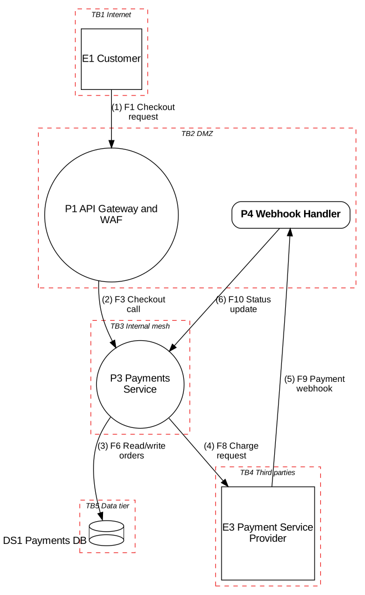

# Threat Model: OrbitPay (TM-001)

The complete, machine-readable version of the case study in the main guide
([Part III, Section 11](../../README.md#11-case-study-orbitpay)). **OrbitPay is fictional**;
every threat in it has appeared in real systems.

| Field | Value |
|---|---|
| Model ID | TM-001 |
| System / version | OrbitPay checkout and payments orchestration, v1.0 |
| Owner (team) | payments-team |
| Facilitator | security-team |
| Last reviewed | 2026-10-19 |
| Review triggers | New trust boundary, new external dependency, new data class, authN/authZ change, incident |
| Risk tier | Critical |
| Rating scale | Calibrated 5x5 ([Section 8.2](../../README.md#82-a-recommended-default-calibrated-55-matrix)) |

## Files

| File | What it is |
|---|---|
| [`threats.yaml`](threats.yaml) | Source of truth: element inventory (E/P/DS/F IDs), 25 threats, mitigations, CWE/CAPEC/ATT&CK references, coverage notes |
| [`threat-register.csv`](threat-register.csv) | Spreadsheet export of the register (Appendix C layout), generated by `tools/yaml_to_csv.py` |
| [`orbitpay_tm.py`](orbitpay_tm.py) | Threat model as code with [OWASP pytm](https://github.com/OWASP/pytm): webhook and checkout path |
| [`pytm_report_template.md`](pytm_report_template.md) | Report template for pytm |
| [`diagrams/pytm-dfd.png`](diagrams/pytm-dfd.png) | DFD rendered by pytm + Graphviz |
| [`generated/pytm-report.md`](generated/pytm-report.md) | Raw pytm rule-engine output (uncurated, see below) |

## Reproduce

```bash
pip install -r ../../tools/requirements.txt pytm

# Validate the register and print the STRIDE coverage matrix
python3 ../../tools/validate_threats.py threats.yaml --coverage

# Regenerate the CSV export
python3 ../../tools/yaml_to_csv.py threats.yaml > threat-register.csv

# Threat model as code (needs Graphviz for the DFD)
python3 orbitpay_tm.py --dfd | dot -Tpng -o diagrams/pytm-dfd.png
python3 orbitpay_tm.py --report pytm_report_template.md > generated/pytm-report.md
```

## Data flow diagram

The full Level 0 and Level 1 DFDs (Mermaid, rendered by GitHub) are in the guide:
[Section 5.4](../../README.md#54-example-level-0-context-diagram) and
[Section 11.3](../../README.md#113-level-1-data-flow-diagram).
The pytm excerpt below covers the checkout and webhook path only.



## Scope, assumptions and assets

See [Sections 11.1 to 11.5](../../README.md#111-scope-and-objectives). Key assumptions:
A-02 (raw PANs never reach OrbitPay) and A-03 (internal mTLS). If either is false, re-model.

## Priority threats

| Priority | Threat | Risk | Decision | Owner | Verification |
|---|---|:-:|---|---|---|
| 1 | T-02 Forged PSP webhook marks unpaid orders as paid | 20 Critical | Mitigate before next release | payments-team | Unsigned, mis-signed, stale and replayed webhooks rejected; fulfilment blocked when PSP fetch disagrees |
| 2 | T-04 Client-supplied amount used for PSP charge | 16 High | Mitigate before next release | payments-team | Abuse-case test with modified totals; reconciliation alert |
| 3 | T-16 Card-testing bots abuse checkout | 16 High | Mitigate within sprint | fraud-team | Synthetic card-testing load test; decline-ratio alert |
| 4 | T-11 Cross-tenant BOLA on merchant transactions | 16 High | Mitigate before next release | merchant-team | Automated cross-tenant test suite in CI |
| 5 | T-12, T-15 PSP key leakage; SSRF via merchant callback | 15 High | Mitigate within sprint | platform-team | Secret scanning in CI; SSRF suite against egress proxy |
| 6 | T-08, T-20 Refund accountability; support role can refund | 12 High | Mitigate within sprint | merchant-team | Audit log review; role-endpoint authorization tests |

The other 18 threats (all Medium) are in [`threats.yaml`](threats.yaml) with owners and verification methods.
The attack tree for T-02 is in [Section 11.8](../../README.md#118-deep-dive-attack-tree-for-t-02).

## STRIDE coverage matrix

Generated with `validate_threats.py --coverage`. Cells marked **?** are applicable under
STRIDE-per-element but have no threat and no recorded "None found" decision yet.
They are the work list for iteration 2, which is how T-25 (PII over-collected in audit logs)
was found in iteration 1.

| Element | S | T | R | I | D | E |
|---|---|---|---|---|---|---|
| E1 Customer browser or app | T-01 | n/a | T-23 | n/a | n/a | n/a |
| E2 Merchant users and systems | **?** | n/a | T-08 | n/a | n/a | n/a |
| E3 Payment Service Provider | **?** | n/a | **?** | n/a | T-18 | n/a |
| E4 Email provider | **?** | n/a | **?** | n/a | n/a | n/a |
| P1 API Gateway and WAF | **?** | **?** | **?** | T-14 | T-16 | **?** |
| P2 Auth Service (OIDC) | T-01, T-03 | **?** | **?** | **?** | **?** | **?** |
| P3 Payments Service | **?** | T-04, T-05, T-22 | **?** | T-12, T-22 | T-16, T-18 | T-21 |
| P4 Webhook Handler | T-02 | T-02 | via DS3 (T-09) | None found | T-17 | None found |
| P5 Notification Worker | **?** | **?** | **?** | T-15 | **?** | T-15 |
| P6 Merchant Admin API | via P2 (T-03) | T-05, T-06 | T-08 | T-11 | None found (P1 rate limits; accepted) | T-11, T-20 |
| DS1 Payments DB | n/a | T-06 | n/a | T-11, T-13 | T-19 | T-11 |
| DS2 Event Queue | T-07 | T-07 | n/a | **?** | **?** | n/a |
| DS3 Audit Log Store | n/a | T-09 | T-09, T-10 | T-25 | None found | n/a |
| DS4 Secrets Manager | n/a | **?** | n/a | T-12 | **?** | n/a |
| F1 Checkout (HTTPS, JWT) | n/a | T-04 | n/a | **?** | T-16 | n/a |
| F2 Token validation | n/a | **?** | n/a | **?** | **?** | n/a |
| F3 Checkout calls | n/a | **?** | n/a | **?** | **?** | n/a |
| F4 Admin actions (HTTPS, SSO + MFA) | n/a | **?** | n/a | **?** | **?** | n/a |
| F5 Admin calls | n/a | **?** | n/a | **?** | **?** | n/a |
| F6 Read and write orders | n/a | **?** | n/a | **?** | **?** | n/a |
| F7 Read orders, issue refunds | n/a | **?** | n/a | **?** | **?** | n/a |
| F8 Charge and refund (HTTPS, API key) | n/a | T-24 | n/a | T-24 | T-18 | n/a |
| F9 Payment webhook (HTTPS) | T-02 | T-02 | n/a | None found (TLS; contains no PII) | T-17 | n/a |
| F10 Payment status update | n/a | **?** | n/a | **?** | **?** | n/a |
| F11 Publish payment events | n/a | **?** | n/a | **?** | **?** | n/a |
| F12 Consume events | n/a | **?** | n/a | **?** | **?** | n/a |
| F13 Receipt emails (API) | n/a | **?** | n/a | **?** | **?** | n/a |
| F14a Audit events (Payments) | n/a | **?** | T-10 | **?** | **?** | n/a |
| F14b Audit events (Admin API) | n/a | **?** | T-10 | **?** | **?** | n/a |
| F14c Audit events (Webhook) | n/a | **?** | T-10 | **?** | **?** | n/a |
| F15 PSP key, DB credentials | n/a | **?** | n/a | T-12 | **?** | n/a |
| F16 Merchant callback (HTTPS) | n/a | **?** | n/a | T-15 | **?** | T-15 |

`**?**` = applicable per STRIDE-per-element but no threat recorded. Record a threat, or write "None found" with a reason in the model document.

## Change log

| Date | Change | Author |
|---|---|---|
| 2026-10-19 | Iteration 1: 24 threats from workshop; T-25 added from coverage check | Bilal Ahmad Kamal |
